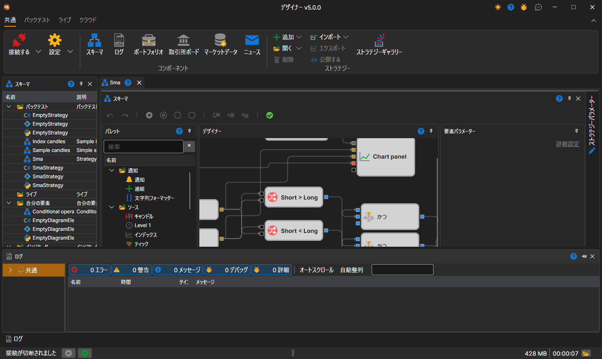

# ワークスペース

[Designer](../../designer.md) の **ワークスペース** は、Microsoft Visual Studio で使用されているものに似たパネル ドッキングを備えたウィンドウ インターフェイスです。パネルのヘッダーをマウスの左ボタンでクリックして押したままにすると、パネルを便利な場所に固定できます。パネルの端をドラッグすると、高さまたは幅を調整できます。

ウィンドウの下部にはステータスバーがあります。[Designer](../../designer.md) が接続されているかどうか（**接続が切断されました**、**接続済み**、または接続エラーのテキスト）、StockSharp のニュース、ログの警告とエラーのカウンター、最新のログメッセージ（クリックすると [ログパネル](logs.md) が開きます）、使用メモリ、稼働時間、ログフォルダーのボタンが表示されます。これらの詳細は、Terminal の [ステータスバー](../../terminal/user_interface/status_bar.md) セクションで説明しています。

## 推奨コンテンツ

[スキーム](schemas.md)

