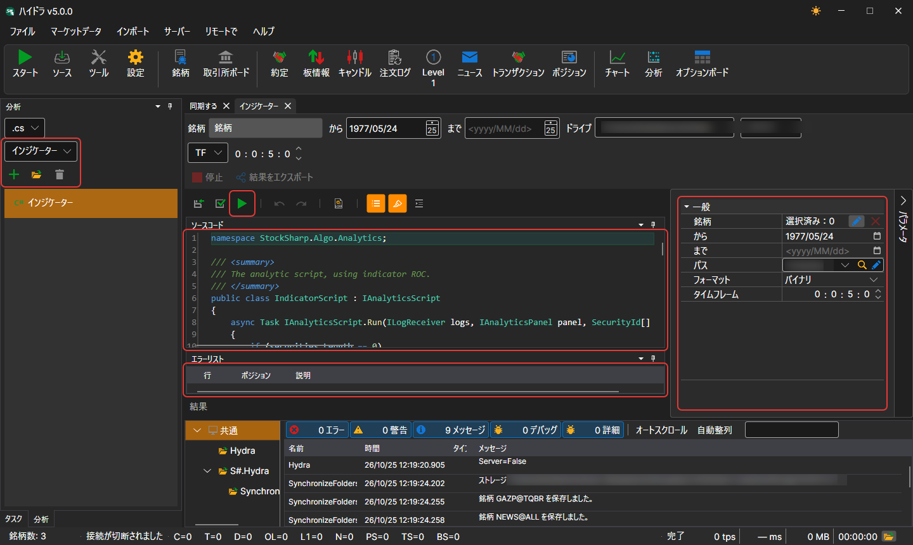
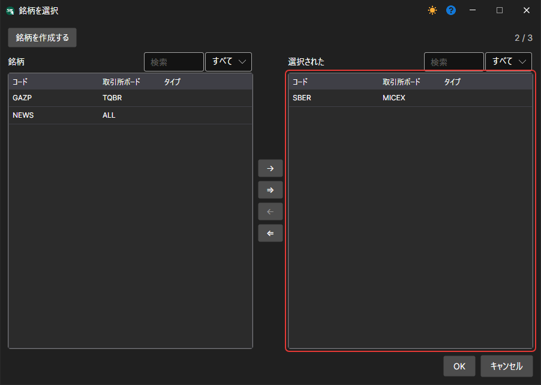

# スクリプトの実行

新しい分析スクリプトを作成するには、左側のパネルで **分析** タブを開き、スクリプトの言語とすぐに開始するためのテンプレートを選択して、**追加** をクリックします。スクリプトは別のタブで開きます。

スクリーンショットには、この機能のメインインターフェイスが示されており、いくつかの主要コンポーネントで構成されています。

- **「分析」パネル**: 左側で、新しいスクリプトの言語とテンプレート（日中出来高、ボリュームプロファイル、チャート、インジケーター、その他の分析ツール）を選択します。その下には、アイコンボタン **追加**、**開く**、**削除**（ボタン名はツールチップに表示されます）と、作成済みスクリプトの一覧があります。
- **実行パラメーターとボタン**: コードの上で銘柄、期間、ストレージ、フォーマット、時間枠を指定し、ボタンで **ソースを保存**、**参照**（スクリプトが参照するアセンブリとパッケージ）、**ソースをコンパイルして実行**、**停止**、**結果をエクスポート** を実行します。
- **コードウィンドウ**: コードウィンドウには、選択された分析スクリプトのソースコードが表示されます。ユーザーはコードを直接編集して、分析計算や戦略をカスタマイズまたは作成できます。
- **パラメーターパネル**: 右側にあり、**パラメータ** ボタンで展開します。このパネルでは、銘柄の選択、分析期間、データパス、その他の設定など、分析スクリプトのパラメーターを設定できます。
- **エラー一覧**: インターフェイス下部には、分析スクリプトのコンパイルまたは実行中に検出されたエラーの一覧があります。

分析スクリプトは、[IAnalyticsScript](xref:StockSharp.Algo.Analytics.IAnalyticsScript) から継承したクラスとして記述されます。

パラメーターを設定する場合:

- **銘柄** は、スクリプトのロジックに応じて 1 つから複数の銘柄に設定できます。

- 日付範囲。
- データを取得するストレージ。
- スクリプトが時間枠を使用する場合、その作業時間枠。

 ボタンをクリックすると、スクリプトがコンパイルされて実行され、その結果が新しいタブに表示されます。
