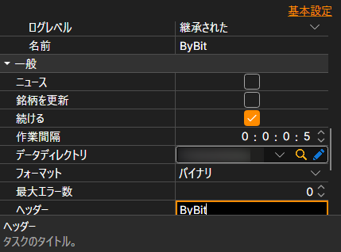

# 共通接続設定

すべてのソースに共通する接続プロパティです。

**一般**

各ソース固有の設定（キー、アドレス、再接続）が最初に表示されます。その後に、すべてのソースに共通する設定が続きます。

- **ニュース** - ニュースをダウンロードします。
- **銘柄を更新** - 接続時に銘柄を更新します。
- **続ける** - 最後にダウンロードした日付からダウンロードを続けます。
- **作業間隔** - 動作間隔。
- **データディレクトリ** - StockSharp 形式の最終ファイルを保存するデータ ディレクトリ。
- **フォーマット** - データ形式: BIN\/CSV。
- **最大エラー数** - タスクを停止するまでの最大エラー数。既定値は 0 で、エラー数を無視することを意味します。
- **ヘッダー** - タスクのタイトル。
- **作業時間** - タスクの作業スケジュール。
- **検証** - 検証に通らなかったデータの扱い: 何もしない、削除する、またはサブスクリプションを停止する。

**リモートで**

- **有効** - タスクをリモートで管理します。
- **通知** - タスクに関する通知が届くチャネル。
- **ログレベル** - タスクのどのメッセージをチャネルに送信するか。
