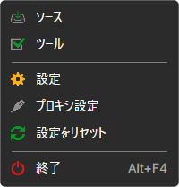
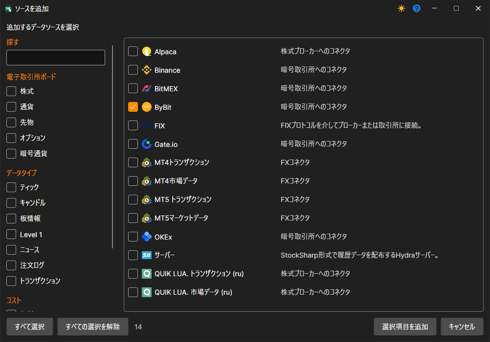
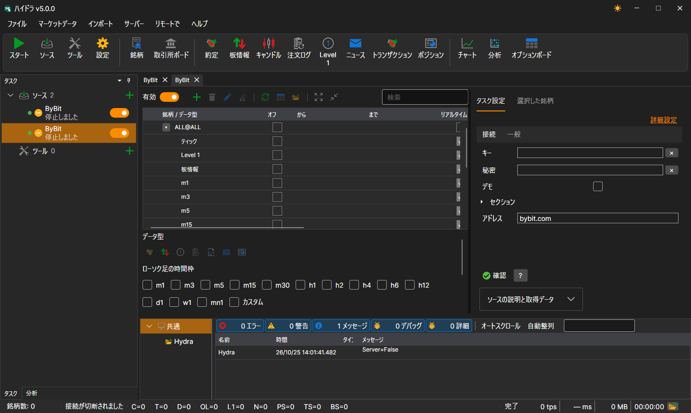
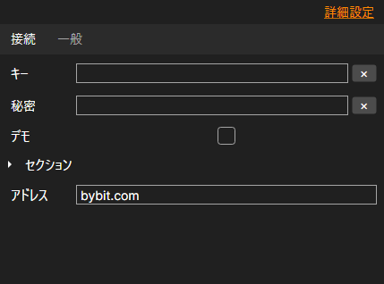

# ソースの選択

新しいマーケット データ ソースを追加するには、**ファイル** メニューを開いて **ソース** 項目を選択するか、ツールバーの **ソース** ボタンをクリックします。

ソースの一覧が開きます。チェックボックスまたは名前をクリックして複数のソースを同時に選択し、**選択項目を追加** をクリックします。

同じソースのインスタンスを複数追加することもできます。たとえば、キーが異なる、またはダウンロードしたデータの保存先フォルダーが異なる 2 つの **ByBit** です。各インスタンスは、**タスク** パネル上の個別のタスクになります。それらを区別するには、ソース設定の **一般** タブにある **ヘッダー** を使います。

**スタート** ボタンをクリックした後にソースがデータをダウンロードするには、そのソースを有効にしておく必要があります。そのためのスイッチ  は、**タスク** パネルの各ソースと、ソースの銘柄テーブルの上（**有効**）にあります。ソースは、銘柄を追加する前でも後でも有効にできます。

不要なソースは、**タスク** パネルにあるソースのコンテキストメニューの **削除** コマンドで削除します。

ソースの設定は、銘柄テーブルの右側にある **タスク設定** タブにあります。**接続** タブには、それがないとソースが接続できない設定（キー、アドレスなど）があり、**一般** タブにはそれ以外の設定があります。**詳細設定** リンクをクリックすると、基本的なパラメーターだけでなく、ソースのすべてのパラメーターが表示されます。

すべてのソースに共通する設定は、[共通接続設定](common_connection_settings.md) の項目にあります。

各接続には固有の特性があります。[コネクタ一覧](../data_sources.md) のリンクには、コネクタとその設定の一覧が示されています。

**[ビデオ チュートリアル](../videos/sources_samples.md)を見る**
