# 初回起動

初回起動時、Hydra はデータ ソースの選択を求めます。後から同じウィンドウを開くには、ツールバーの **ソース** ボタンを使うか、**ファイル** メニューから開きます。

必要なソースにチェックを付けます。チェックボックスと名前のどちらをクリックしてもかまいません。左側のフィルター（ボード、データ型、料金）で一覧を絞り込めます。**探す** フィールドでは名前で検索できます。例として **ByBit** にチェックを付け、**選択項目を追加** をクリックします。

続いて、ユーティリティの同じようなウィンドウが開きます。ユーティリティは、データをダウンロードするのではなく、ダウンロード済みのデータを扱うタスクです。スケジュールに従ったインポートとエクスポート、変換、クラウドへのバックアップなどがあります。詳しくは [ユーティリティ](tasks.md) セクションを参照してください。今はユーティリティが不要であれば、**キャンセル** をクリックします。

追加した各ソースについて、Hydra は今すぐ有効にするかどうかを尋ねます。有効なソースは **スタート** ボタンが押されたときにデータをダウンロードし、無効なソースはスキップされます。**はい** と答えます。

ソースが左側の **タスク** パネルに表示され、中央にそのソースのパネルが開きます。銘柄テーブル、その下に受信データの設定、右側に接続設定があります。

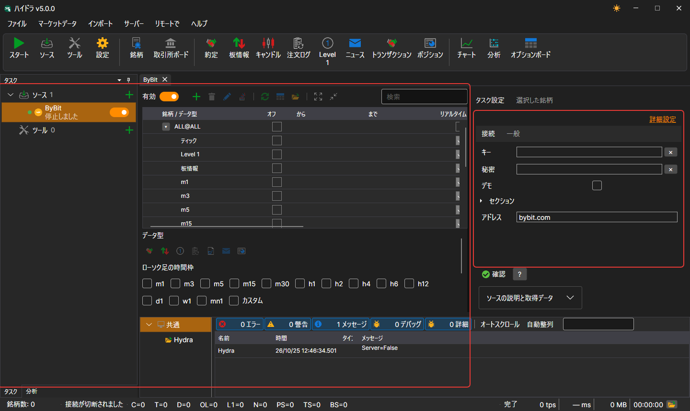

## 銘柄

> [!TIP]
> データは、ソースに追加された銘柄についてのみダウンロードされます。

ソースを追加した直後は、サービス用の銘柄 **ALL@ALL**（「ソースのすべての銘柄」）しかありません。この銘柄では、ソースがすべての銘柄について一度に提供できるデータがダウンロードされます。例として、現物ペア BTCUSDT を追加します。

1. 銘柄テーブルの上にある **銘柄を追加**  ボタンをクリックします。選択ウィンドウが開きます。左側は Hydra が認識している銘柄、右側はソース用に選択された銘柄です。

   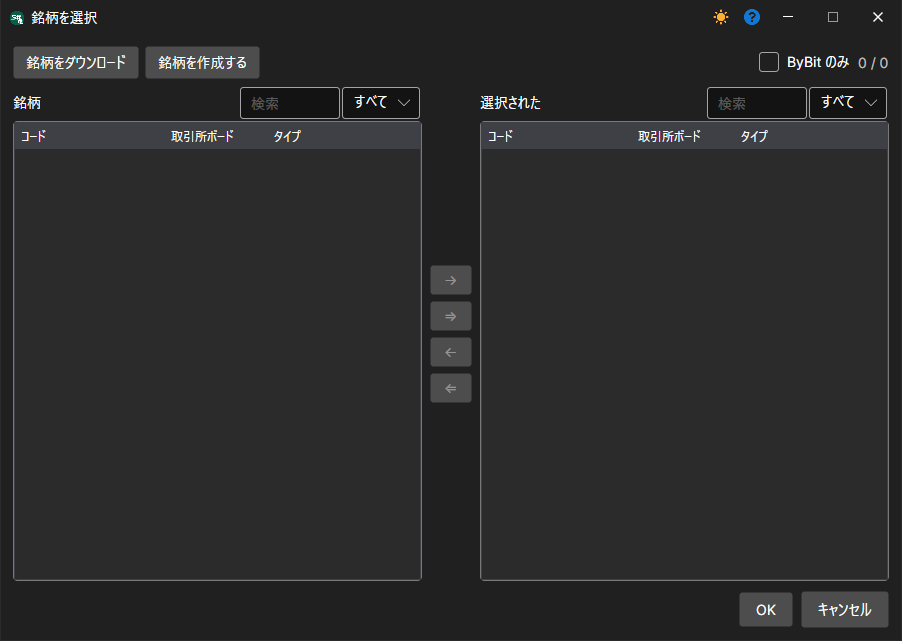

2. 初回は左側の一覧が空です。Hydra はまだ銘柄を 1 つも認識していません。**銘柄をダウンロード** をクリックします。開いたウィンドウで検索条件を指定します。**すべて** チェックボックスを選択すると、ソースに一覧全体を要求します。

   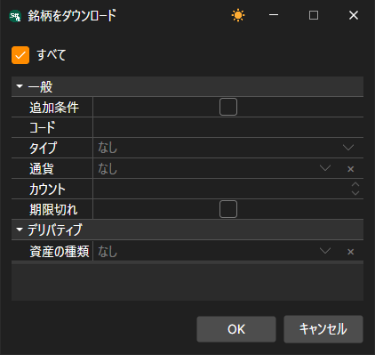

   一部のソースでは、一覧全体の代わりに必要な銘柄を[指定](prepare_for_download/instruments_list.md)できます。

3. **OK** をクリックします。ソースが応答すると、Hydra は追加された新しい銘柄の数を知らせ、それらが左側の一覧に表示されます。一覧の上のカウンターには、表示されている銘柄の数と、認識されている銘柄の総数が表示されます。**ByBit のみ** チェックボックスを選択すると、ほかのソースがすでにダウンロードしている銘柄が非表示になります。

   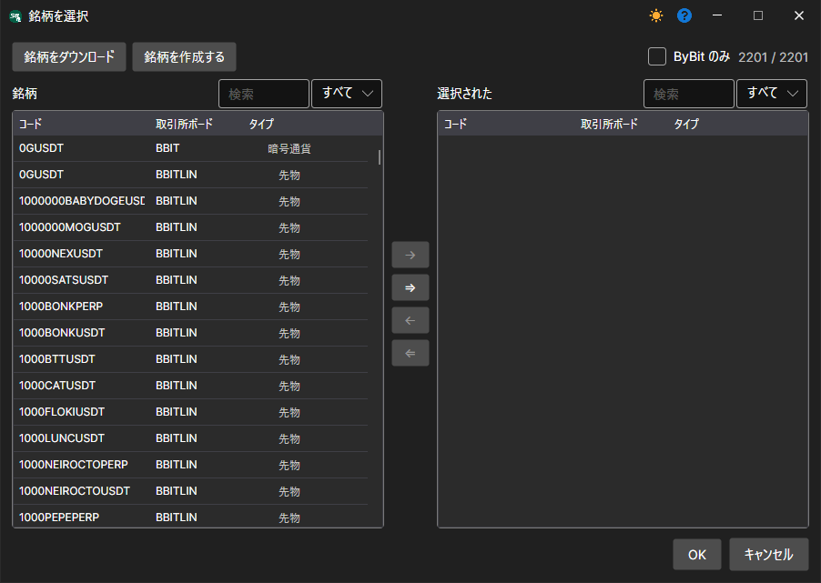

4. 一覧の上にある **検索** フィールドに銘柄コードを入力し始めます。

   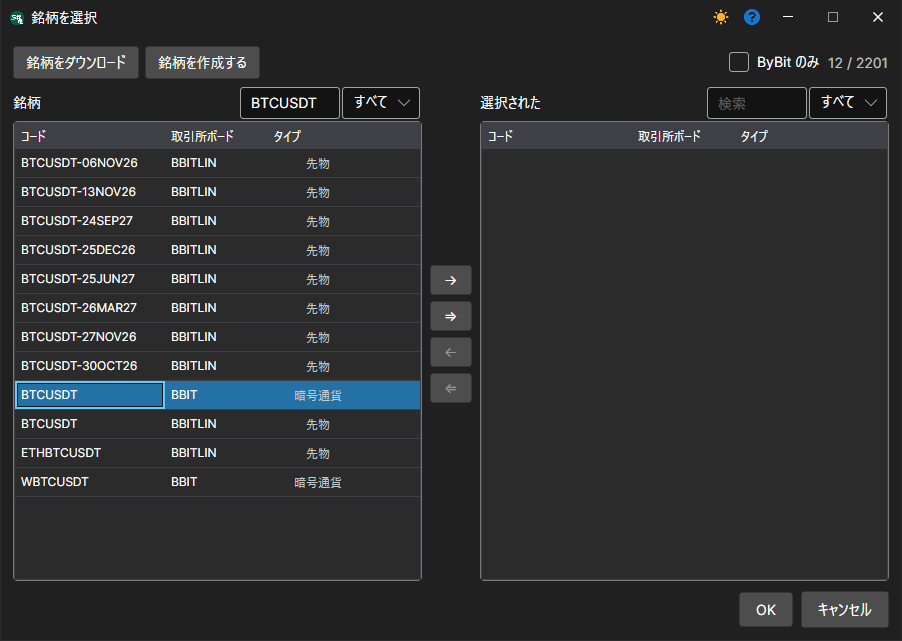

5. ダブルクリックまたは矢印ボタンで銘柄を右側へ移動し、**OK** をクリックします。

   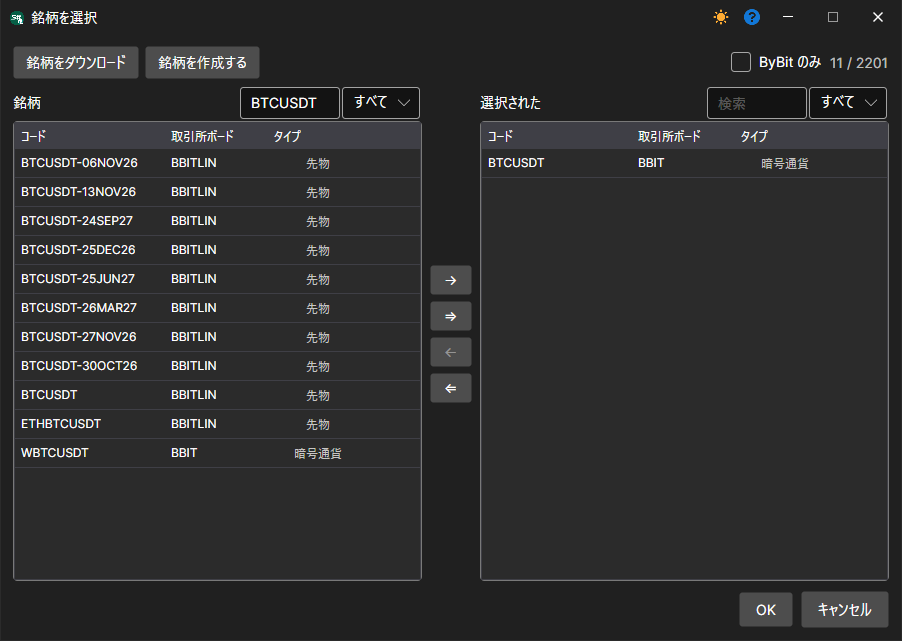

## データ型と期間

銘柄を選択すると、Hydra はそれらについてどのデータをダウンロードするかを尋ねます。**ティック** と 5 分のローソク足 **TF: 00:05:00** にチェックを付けます。クリックするたびに、選択にデータ型が 1 つずつ追加されます。

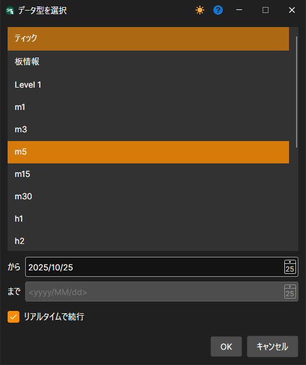

**から** の日付は履歴の開始日です。**リアルタイムで続行** チェックボックスを選択すると、履歴のダウンロード後もソースはデータを受信し続けます。この場合、**まで** の日付は不要です。ソースが提供する履歴の量は、そのソース自体によって異なります。

**OK** をクリックすると、銘柄がソースのテーブルに表示されます。テーブルはツリー構造で、銘柄の行にはそのコードがあり、その下に選択したデータ型が開始日と終了日とともに表示されます。

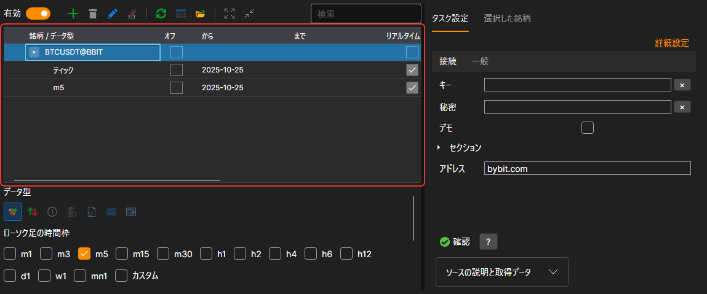

銘柄に対してデータ型が 1 つも選択されていない場合、または価格ステップ、数量ステップ、小数点以下の桁数が設定されていない場合は、その行の左側に ⚠ アイコンが表示されます。アイコンのツールチップに、何が不足しているかが説明されます。

テーブルの下には、テーブルで選択した行の設定があります。1 つまたは複数の行を選択すると、設定はそれらすべてに一度に適用されます。

- **データ型** — 受信するデータ。利用できる種類はソースによって異なります。

  

- **ローソク足の時間枠** — ダウンロードするローソク足。時間枠の一覧もソースによって異なります。**カスタム** をクリックすると、[独自のローソク足タイプ](prepare_for_download/custom_candles.md)を指定するウィンドウが開きます。

  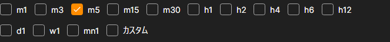

- **から** と **まで** — ダウンロード期間。終了日がない場合、ソースは本日までに存在するすべてのデータをダウンロードします。ソースがリアルタイムで動作でき、**リアルタイム** チェックボックスが選択されている場合は、その後もデータを受信し続けます。

  **ローソク足の生成** — ローソク足の取得元です。**ロード** はソースから完成したローソク足を取得し、**ビルド** は Hydra 自体で生成し、**ロードしてビルド** はロードしたうえで不足分を生成します。**生成フィールド** — 何からローソク足を生成するかです。最終約定価格、スプレッドの中央値、最良価格などを選べます。ソースが必要な時間枠のローソク足を提供しない場合は、ローソク足を生成すると便利です。

  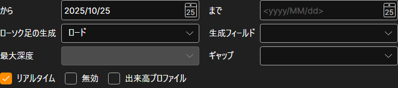

## ダウンロード

ツールバーの **スタート** をクリックします。ソースが接続され、ダウンロードが始まります。作業の進行状況はウィンドウ下部の **ログ** パネルで確認でき、ステータスバーには受信したデータの数が表示されます。**C** はローソク足、**T** はティックを表し、ほかのデータ型も同様です。ログは Hydra のフォルダー内のファイルにも保存されます。

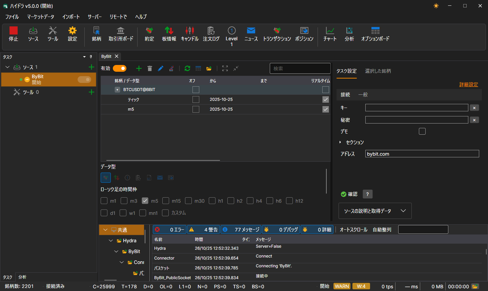

[ほかのソース](data_sources/select_source.md)を追加することもできます。

ダウンロードしたデータは[表示](working_with_data/view_and_export.md)したり、それを使って[ローソク足を生成](working_with_data/candles_generation.md)したり、各種形式に[エクスポート](working_with_data/export_data.md)したりできます。

**[ビデオ チュートリアル](videos/first_start.md)を見る**。
