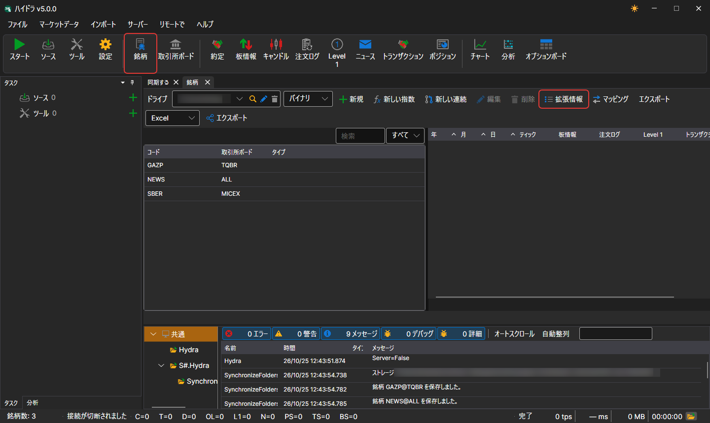
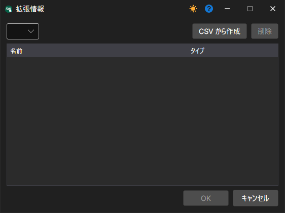

# 拡張銘柄情報

拡張情報のソースは、`c:\\Users\\Users\\Documents\\StockSharp\\Hydra\\Extended info\\` フォルダーに配置された **CSV** ファイルです。これらは [Hydra](../../hydra.md) の起動時に自動的に読み込まれます。

拡張情報には、銘柄に関する任意の追加詳細情報（たとえば、国、都市、取引ボードなど）を含めることができます。

各拡張情報ソース（CSV ファイル）には、銘柄のリストと利用可能なプロパティが含まれています。各ソースの拡張情報は一意です。

ソースに銘柄の拡張情報が含まれていない場合、銘柄リスト内の対応する列は空になります。

必要な拡張情報を選択するには、次の手順を実行します。

1. **銘柄** パネルで **拡張情報** ボタンをクリックします。
2. 必要な CSV ファイルへのパスを選択するウィンドウが表示されます。

以下は、拡張情報の **CSV** ファイルの例です。値はセミコロンで区切られます。1 行目にはプロパティ名、2 行目にはその型、それ以降の各行には銘柄の識別子とそのプロパティの値が入ります。

```
SecurityId;Country;City;Site
string;string;string;string
SBER@TQBR;Россия;Москва;www.sberbank.ru
GAZP@TQBR;Россия;Санкт-Петербург;www.gazprom.ru
```

