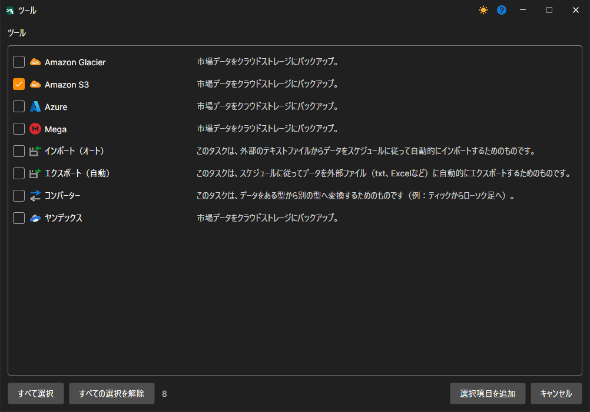
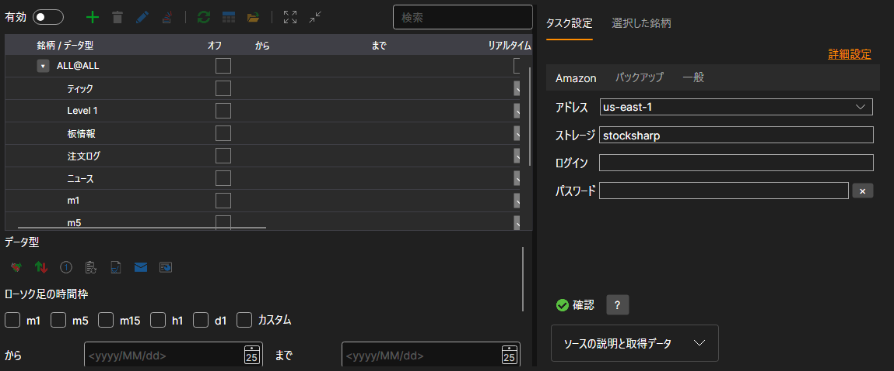

# Hydra 設定

以下では、バックアップタスクの作成と設定方法について説明します。

1. タスクを作成するには、**ツール** ボタンをクリックし、開いたウィンドウで **Amazon S3** 項目にチェックを付けて **選択項目を追加** ボタンをクリックします。タスクを今すぐ有効にするかどうかを尋ねられたら、**いいえ** と答えてもかまいません。タスクは設定後にスイッチで有効にします。
2. 次に、タスクを設定する必要があります。設定はタブに分かれており、**詳細設定** リンクをクリックすると、すべての設定が 1 つの一覧で表示されます。

   **Amazon**
   - **アドレス** - バケット設定で指定したリージョン。[リージョンとエンドポイント](https://docs.aws.amazon.com/general/latest/gr/rande.html#s3_region) を参照してください。
   - **ストレージ** - バケット名。
   - **ログイン** - アクセスキー **Access Key ID**。
   - **パスワード** - アクセスキー **Secret Access Key**。

   **バックアップ**
   - **フォルダー** - データをアップロードするクラウド内のフォルダー。指定しない場合、データはバケットのルートにアップロードされます。
   - **時間オフセット** - 現在の日付からの日数オフセット。終わっていない取引セッションのデータをコピーしないために使います。
   - **エラー** - 失敗した操作（フォルダーの作成、ファイルのアップロード）を、タスクがエラーを報告するまでに何回繰り返すか。

   **全般**
   - **続ける** - 最後にコピーした日付からコピーを続けます。
   - **動作間隔** - 操作の間隔。
   - **データディレクトリ** - 変換対象のデータを取得するデータディレクトリ。
   - **形式** - 変換後のデータ形式: BIN\/CSV。
   - **最大エラー数** - エラーの最大数。この数に達するとタスクが停止されます。既定では 0 で、エラー数は無視されます。
   - **ヘッダー** - タスク名。
   - **作業時間** - タスクの作業スケジュール。チェックボックスをオンにすると **...** ボタンが使用できるようになり、このボタンでスケジュールエディターが開きます。

   **ログ**
   - **ログレベル** - ログレベル。
3. タスクの設定後、バックアップストレージに保存する銘柄を追加し、**開始** ボタンをクリックします。

## 推奨コンテンツ

[アカウントの作成と設定](setup.md)
