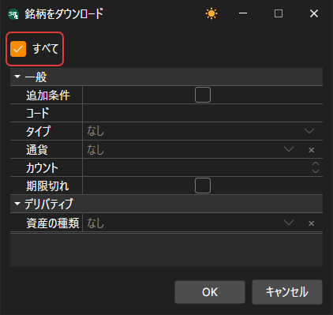
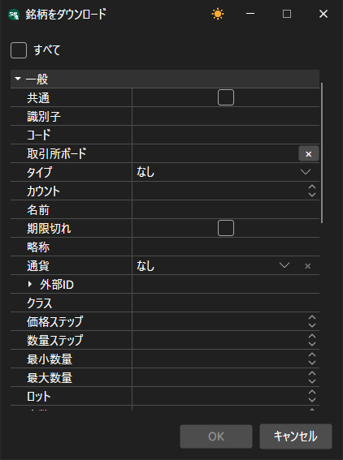
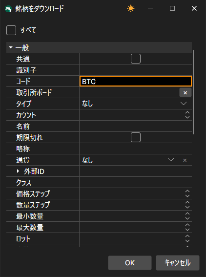
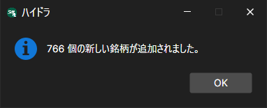
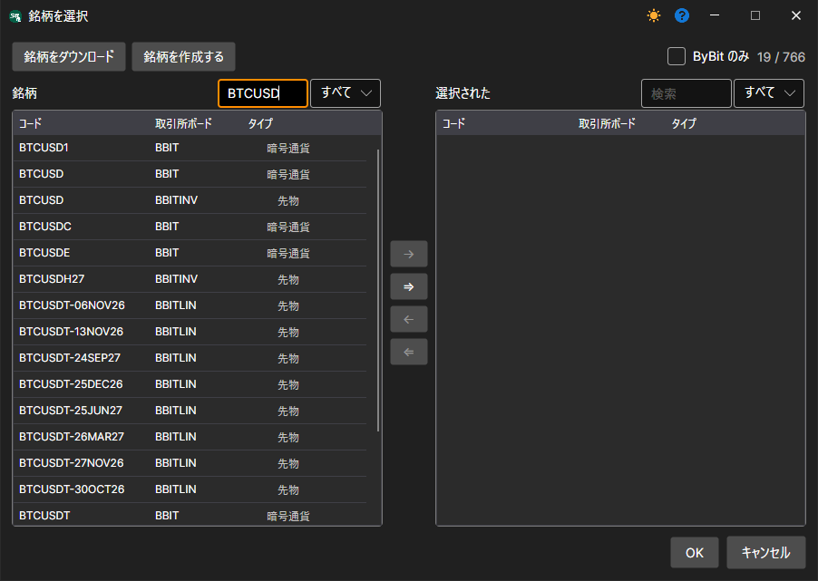
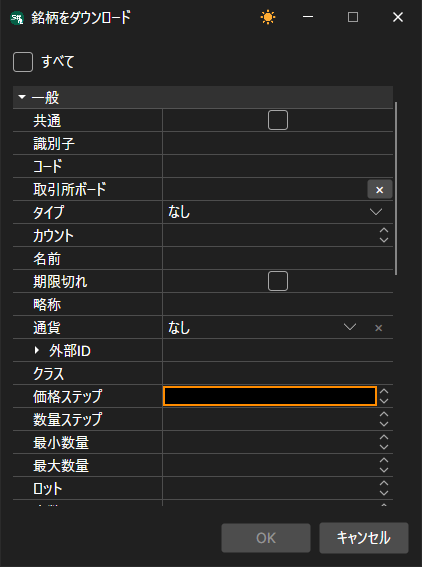
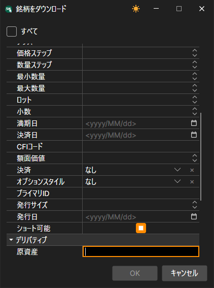

# 銘柄リスト

ダウンロード用の銘柄を設定します。

いくつかのソースでは、必要な銘柄をダウンロードするための設定を行うことができます。

**ByBit** ソースから銘柄をダウンロードする例を見てみましょう:

1. **銘柄をダウンロード** をクリックします。既定では **すべて** 項目にチェックが付いており、ソースのすべての銘柄がダウンロードされます。
2. **すべて** のチェックを外し、**追加条件** にチェックを付けます。すると、ダウンロードする銘柄の詳細設定リストが開きます。**共通** にチェックを付けると、簡易リストに戻ります。
3. コードに BTC を含む銘柄をダウンロードする必要があります。これを行うには、**コード** フィールドに BTC を指定し、**OK** をクリックします。

   その後、[Hydra](../../hydra.md) プログラムは、指定したパラメーターを満たすすべての銘柄をダウンロードし、そのうち新しい銘柄がいくつあるかを知らせます。 

この設定により、ユーザーはダウンロードする銘柄のさまざまなパラメーターを選択できます。

たとえば、ユーザーは次を選択できます:

- **価格と出来高のステップ**
- **最小出来高と最大出来高**
- **外部 ID** 
- オプションについては、**原資産** と **資産タイプ** (原資産となる銘柄の種類) を設定できます。 

**[ビデオチュートリアルを見る](../videos/instruments_downloading.md)**
