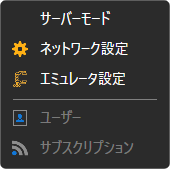
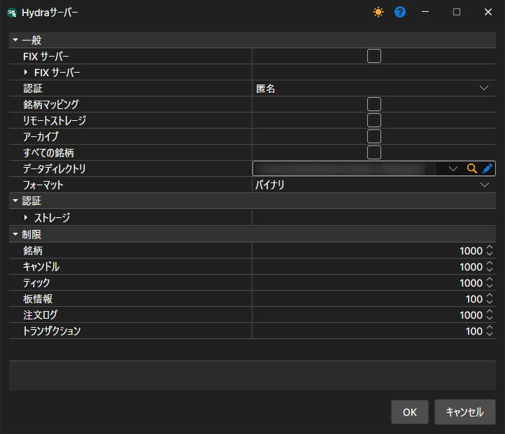
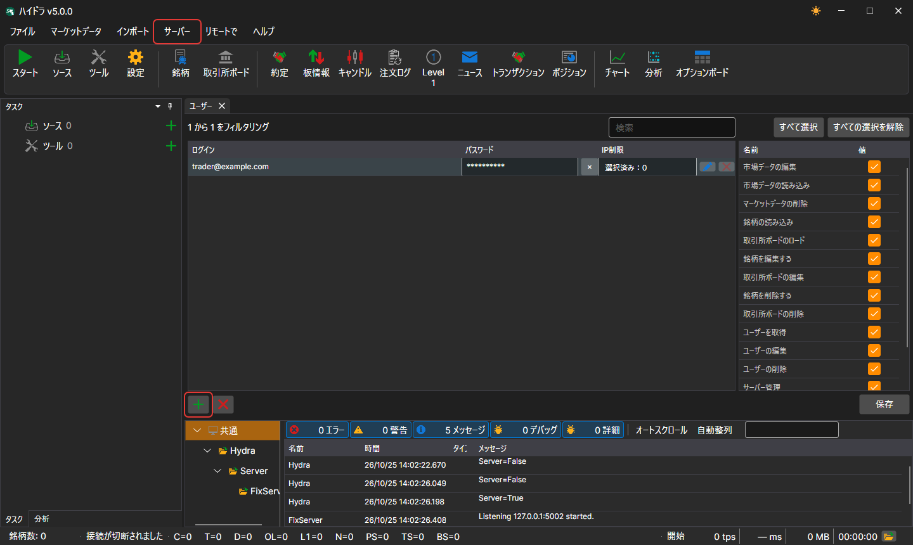

# 設定

[Hydra](../../hydra.md) はサーバーモードで使用できます。このモードでは [Hydra](../../hydra.md) にリモート接続し、ストレージ内の既存データを取得できます。サーバーモードで動作している [Hydra](../../hydra.md) には、[Designer](../../designer.md) から接続できます (その方法については [はじめに](../../designer/market_data_storage/getting_started.md) を [Designer](../../designer.md) ドキュメントで参照してください)。また、[Hydra](../../hydra.md) には [API](../../api.md) 経由で接続することもできます (詳細は [FIX/FAST 接続](fix_fast_connectivity.md) セクションを参照してください)。

サーバーモードでは、[Hydra](../../hydra.md) プログラムにより、ユーザーは1つの接続を使って複数のプログラムで同時に作業できます。プログラム設定でアクセスキーを設定することで、ユーザーは1つのアカウントで1つのソースを同時に使用できます。

実際には、ソースへの接続は [Hydra](../../hydra.md) 経由で行われ、たとえば [Designer](../../designer.md) や [Terminal](../../terminal.md) が同時に接続されます。この方法により、プログラム間の再接続や追加接続の購入を避けることができます。このような作業では、異なるプログラムからの注文登録や取引によって発生する競合が排除されます。[Hydra](../../hydra.md) はシグナルを受信し、それを受信したプログラムへ結果を返します。その間、他の作業の順序は乱されません。

[Hydra](../../hydra.md) サーバーモードを有効にするには、**サーバー** メニューで **サーバーモード** 項目を選択します。

その後、同じメニューで **ネットワーク設定** 項目を選択すると、サーバーモード設定ウィンドウが開きます。

**Hydra サーバー**

- **FIX サーバー** - [Hydra](../../hydra.md) をサーバーモードに切り替え、FIX プロトコル経由でライブ取引データと履歴データを配信します。

  このセクションでは、ソースを使用するための接続を設定します:
  1. **ConvertToLatin** - キリル文字をラテン文字に変換
  2. **QuotesInterval** - 気配値の更新期間
  3. **TransactionSession** - 取引セッションの設定。[Hydra](../../hydra.md) プログラム経由で取引するための設定。

     この設定により、FIX プロトコルのダイアレクト、送信者と受信者、データ形式、およびその他の設定を構成できます。詳細は [FIXServer プロパティ](https://doc.stocksharp.com/html/Properties_T_StockSharp_Fix_FixServer.htm) を参照してください。
  4. **MarketDataSession** - [Hydra](../../hydra.md) を使用して受信したマーケットデータを転送するための設定。詳細は [FIXServer プロパティ](https://doc.stocksharp.com/html/Properties_T_StockSharp_Fix_FixServer.htm) を参照してください。
  5. **KeepSubscriptionsOnDisconnect** - ソースから切断されたときにサブスクリプションを保持します。
  6. **DeadSessionCleanupInterval** - 接続が切断された場合、どの時間間隔後に情報をクリアするか。
- **認証** - Hydra サーバーへのアクセス権を得るための認証
- **ストレージ**（**認証** グループ） - サーバーのユーザーを保存する場所: **ファイル** または **データベース**。データベースの場合は、その **接続** と **テーブル**（既定では **HydraUsers**）を指定します。データベースには、パスワードそのものではなくハッシュが保存されます。
- **銘柄数** - サーバーからリクエストできる銘柄の最大数
- **ローソク足（日）** - ローソク足履歴をダウンロードできる最大日数
- **ティック（日）** - ティックデータ履歴をダウンロードできる最大日数
- **板情報（日）** - 板情報履歴をダウンロードできる最大日数
- **OL（日）** - OL データ履歴をダウンロードできる最大日数
- **トランザクション（日）** - トランザクション履歴をダウンロードできる最大日数
- **シミュレーター** - シミュレーターモードをオンにします
- **銘柄マッピング** - 指定した銘柄のみの転送モードを有効にします。

**認証** を **匿名** 以外に設定し、**サーバーモード** を有効にすると、**サーバー** メニューの **ユーザー** 項目が使用できるようになり、**ユーザー** ウィンドウが開きます。

ウィンドウの左側はユーザーの一覧です。**追加** で新しいユーザーを作成し、**削除** で選択したユーザーを削除し、**保存** で変更を書き込みます。右側には、選択したユーザーのメールアドレスとパスワード、接続を許可するアドレス、およびその権限が表示されます。権限はそれぞれチェックボックスで指定し、**すべて選択** と **すべての選択を解除** で、すべてを一度にオンまたはオフにできます。

サーバーの実行中は、**サーバー** メニューの **サブスクリプション** 項目を使用できます。この項目は、サーバーに接続しているクライアントのマーケットデータのサブスクリプションを表示するパネルを開きます。
