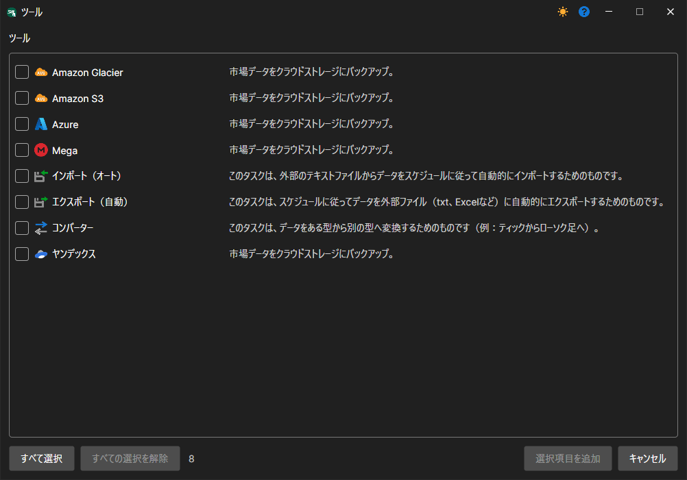

# タスク

ツールは、特定の時刻に繰り返されるアクションです。

ツールは、左側の **タスク** パネルの **ツール** グループにまとめられています（[ユーザーインターフェイス](user_interface.md) を参照）。ツールの操作はソースの場合と同じです。ツールは追加、削除、編集、有効化\/無効化できます。**ツール** を追加するには、**ファイル** メニューで **ツール** 項目を選択します。必要な **ツール** を選択できる対応するウィンドウが表示されます...

現在、[Hydra](../hydra.md) には4つのタスククラスがあります

- [インポート（自動）](tasks/import_auto.md) - CSV 形式からデータをインポートするタスクです。
- [コンバーター](tasks/converter.md) - 取引所データをティック、ローソク足、または板情報に変換するタスクです。
- [エクスポート（自動）](tasks/export_auto.md) - ローソク足をさまざまな形式にエクスポートするタスクです。
- [バックアップ](misc/backup.md) - クラウドサービスへデータをバックアップするタスクです。
