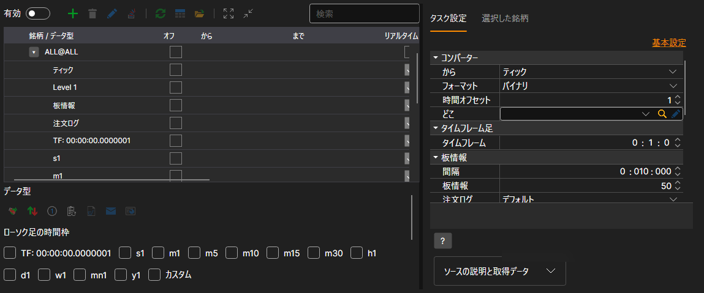
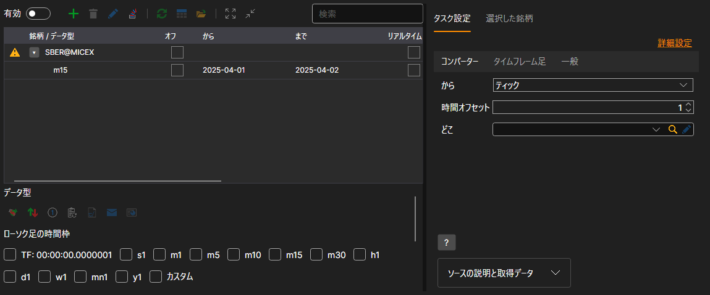
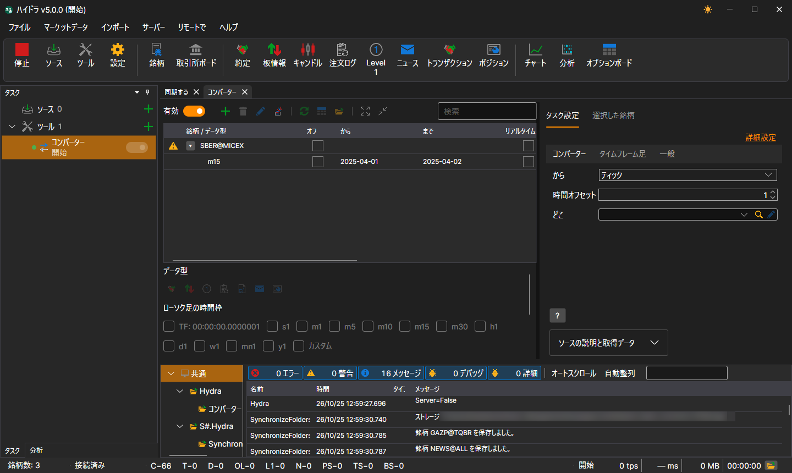
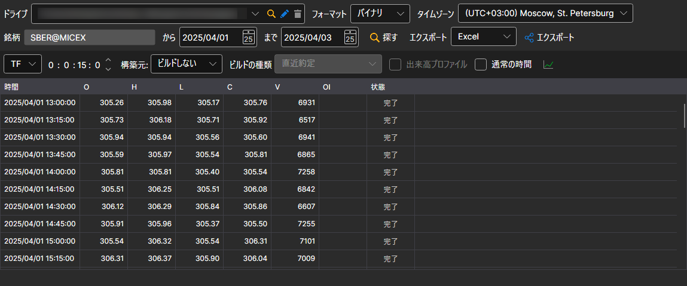

# コンバーター

このタスクは取引所データを変換します。たとえば、注文ログからティックへ、またはティックからローソク足へ変換する、などです。

このタスクは **ツール** ボタンで追加します。開いたウィンドウで **コンバーター** 項目にチェックを付け、**選択項目を追加** ボタンをクリックします。タスクの設定はタブに分かれており、**詳細設定** リンクをクリックすると、すべての設定が 1 つの一覧で表示されます。

**コンバーター**

- **変換元** - どのデータ型を変換するか。
- **フォーマット** - 変換後のデータ形式: BIN\/CSV。
- **時間オフセット** - タスクが開始された日付からの日数で表す時間オフセット。これにより未完成日の変換を防ぎます。リアルタイムデータ変換が設定されている場合、更新間隔によって現在日が部分的にしか変換されないことがあります。それを避けるために時間オフセットを使用します。
- **保存先** - 変換後のデータを保存するデータディレクトリ。

**タイムフレーム足**

- **タイムフレーム** - **変換元** フィールドでローソク足を選択した場合に、変換元となるローソク足の時間枠。

**板情報**

- **間隔** - 板情報の生成間隔。
- **深度** - 板情報生成の最大深度。
- **注文ログ** - 注文ログから板情報を構築する方法。

  ほとんどの場合は **デフォルト** が適しています。接続に独自の注文ログ形式がある場合（たとえばモスクワ取引所の **Plaza**）、その形式は接続が確立されたときにリストに表示されます。

**全般**

- **続ける** - 最後に変換した日付から変換を続けます。
- **動作間隔** - 動作間隔。
- **データディレクトリ** - 変換用のデータを受け取るデータディレクトリ。
- **形式** - 変換対象のデータ形式: BIN\/CSV。
- **最大エラー数** - エラーの最大数。この数に達するとタスクは停止されます。既定では 0 で、エラー数は無視されます。
- **ヘッダー** - コンバーター。
- **作業時間** - タスクの作業スケジュール。 

**ログ**

- **ログレベル** - ログレベル。

データ変換の例を見てみましょう。

1. **コンバーター** タスクに移動し、テーブルの上にある **+** ボタンで銘柄を追加します。 
2. 表示されるウィンドウで、変換中に受け取るべきデータ型と期間を設定します。変換元となるデータ型は **変換元** 設定で指定します。たとえば、ティックを時間枠 15 分のローソク足に変換する必要があるとします。

   > [!TIP]
> 重要\! 要求するデータ期間は、変換可能な期間と一致している必要があります。一致していない場合、データは変換されません。設定では、変換対象データの形式と一致するように、正しいソースデータ形式を指定してください。
3. 必要なディレクトリを指定します。時間オフセット。動作間隔。
4. **有効** スイッチでタスクを有効にし、**スタート** ボタンで変換を開始します。 

データが変換されたことがわかります。生成されたデータを[確認してみましょう](../working_with_data/view_and_export.md)。

この機能は、別のデータ型から[必要なマーケットデータを取得する](../working_with_data/any_market_data_types.md)機能に似ています。

**[ビデオチュートリアルを見る](../videos/converter_task.md)**
