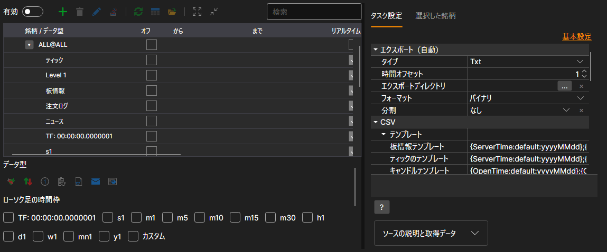
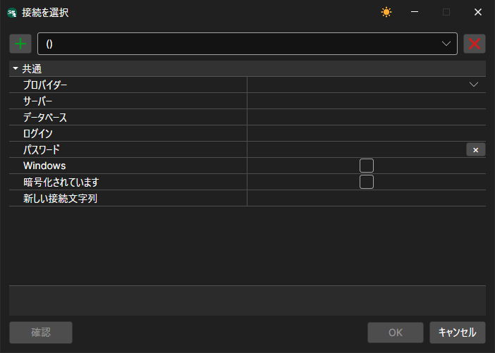
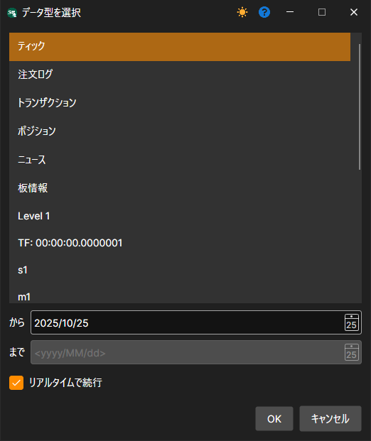
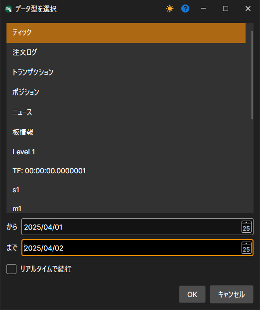
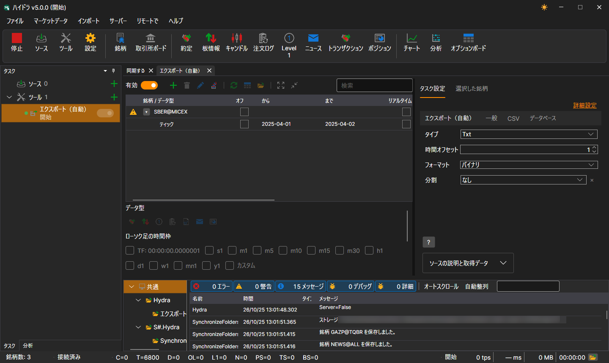

# エクスポート（自動）

このタスクは、取引所データを Excel、xml、sql、bin、Json、txt などのさまざまな形式にエクスポートします。

このタスクは **ツール** ボタンで追加します。開いたウィンドウで **エクスポート（自動）** 項目にチェックを付け、**選択項目を追加** ボタンをクリックします。タスクの設定はタブに分かれており、**詳細設定** リンクをクリックすると、すべての設定が 1 つの一覧で表示されます。



**エクスポート（自動）**

- **種類** - エクスポートの種類 (形式)。
- **時間オフセット** - 日数で表す時間オフセット。
- **エクスポートディレクトリ** - データをエクスポートするディレクトリ。指定しない場合、ファイルはデータディレクトリに保存されます。
- **形式** - データ形式。
- **分割** - 分割の種類: 日、月、または年ごと。

**データベース**

- **接続** - データベースへの接続。SQL 経由でエクスポートする場合に使用されます。
- **パケット** - 送信されるデータパケットのサイズ。既定ではサイズは50要素です。SQL 経由でエクスポートする場合に使用されます。
- **一意性** - データベース内のデータ一意性をチェックします。パフォーマンスに影響します。既定で有効です。SQL 経由でエクスポートする場合に使用されます。

> [!TIP]
> SQL 経由でエクスポートする場合は、データベースへの接続を指定する必要があります

接続ウィンドウは **接続** フィールドの虫眼鏡ボタンで開き、その中の **+** ボタンで新しい接続を追加します。



- **プロバイダー** - プロバイダー設定。
- **サーバー** - サーバーアドレスまたはデータベースへのパス。
- **データベース** - データベース名。SQLite では使用されません。
- **ログイン** - データベースへアクセスするためのログイン。匿名アクセスでは使用されません。
- **パスワード** - データベースへアクセスするためのパスワード。匿名アクセスでは使用されません。
- **Windows** - データベースへ接続するために現在の Windows アカウントを使用します。
- **暗号化されています** - サーバーへの接続を暗号化します。
- **新しい接続文字列** - 既成の接続文字列。

> [!TIP]
> **確認** ボタンを使用して、データベースへの接続を確認できます。

**CSV**

- **テンプレート** - エクスポートされる各データ型のテンプレート。
- **ヘッダー** - 先頭行のヘッダー。空文字列が渡された場合、ヘッダーはファイルに追加されません。
- **ファイル名の形式** - エクスポートされるファイル名を記録するための形式。

**全般**

- **続ける** - 最後にエクスポートした日付からエクスポートを続けます。
- **動作間隔** - 動作間隔。
- **データディレクトリ** - エクスポートするデータの取得元となるデータディレクトリ。
- **形式** - 変換後のデータ形式: BIN\/CSV。
- **最大エラー数** - エラーの最大数。この数に達するとタスクは停止されます。既定では 0 で、エラー数は無視されます。
- **ヘッダー** - タスクのタイトル。
- **作業時間** - タスクの作業スケジュール。 

**ログ**

- **ログレベル** - ログレベル。

自動エクスポートの例を見てみましょう:

1. テーブルの上にある **+** ボタンで銘柄を選択します。
2. エクスポートする必要があるマーケットデータを設定します。
3. エクスポート期間を設定します。マーケットデータのリアルタイムダウンロードが設定されている場合、期間の終了日を省略できます。この場合、データは作業間隔 (データ更新) に従ってリアルタイムでエクスポートされます。 
4. ディレクトリ、動作間隔、データ型、データ形式を設定します。
5. **有効** スイッチでタスクを有効にし、**スタート** ボタンでエクスポートを開始します。

エクスポートされたデータを表示してみましょう。既定のティックテンプレートで **Txt** 形式に出力した 4 月 1 日と 2 日の SBER@MICEX のティックは、ファイル `trades_SBER@MICEX_2025_04_01_2025_04_02.csv` に保存され、次のように始まります。

```
20250401;10:00:00.000000;15500000;305.26;88;Buy
20250401;10:00:09.000000;15500001;305.23;2;Sell
20250401;10:00:18.000000;15500002;305.20;48;Sell
20250401;10:00:27.000000;15500003;305.22;46;Buy
20250401;10:00:36.000000;15500004;305.28;105;Sell
```

**[ビデオチュートリアルを見る](../videos/export_task.md)**
