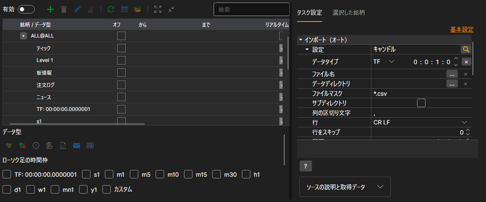
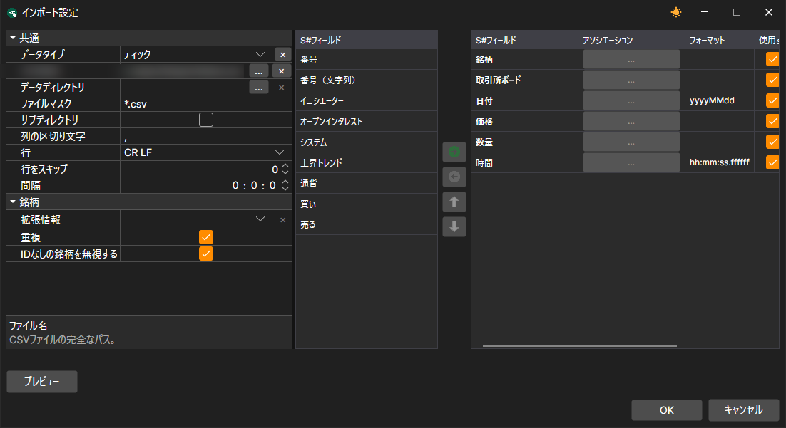
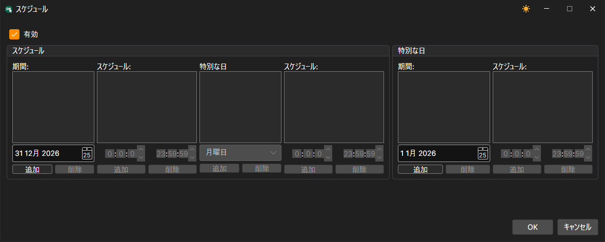
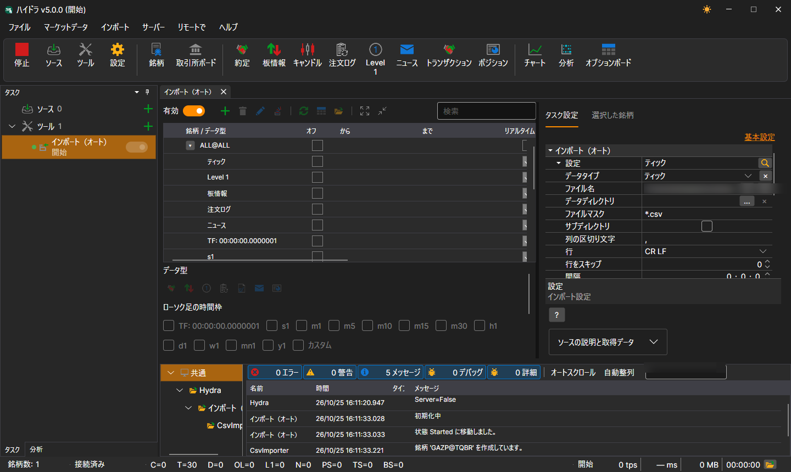

# インポート（自動）

このタスクは、指定したディレクトリ内のファイルから、指定したファイルマスクに従って取引所データを自動インポートします。

このタスクは **ツール** ボタンで追加します。開いたウィンドウで **インポート（オート）** 項目にチェックを付け、**選択項目を追加** ボタンをクリックします。**詳細設定** リンクをクリックすると、タスクのすべての設定が 1 つの一覧で表示されます。

何をどこからインポートするかは、**設定** 行で指定します。この行の虫眼鏡ボタンで開くウィンドウでは、同じ設定に加えて、[インポート](../importing.md) タブと同じようにファイルの列を S# フィールドに対応付けます。

**設定**

- **データ型** - インポートされるデータの種類。
- **ファイル名** - ファイルへの完全パス。
- **データディレクトリ** - 1 つのファイルではなく、ディレクトリ内の該当するすべてのファイルをインポートする場合の、ファイルを含むディレクトリ。
- **ファイルマスク** - ディレクトリをスキャンするときに使用されるファイルマスク。例: candles\*.csv。
- **サブディレクトリ** - サブディレクトリを含めます。
- **列区切り文字** - 列区切り文字。タブは TAB で示されます。
- **行** - ファイル内の行末: CR LF、LF、または CR。
- **行をスキップ** - ファイルの先頭からスキップする行数 (メタ情報を含む場合)。
- **間隔** - データ更新の頻度。
- **拡張情報** - インポートされた拡張フィールドを拡張情報ストレージに保存します。
- **重複** - 重複する銘柄がすでに存在する場合に更新する必要があるかどうか。
- **ID なしを無視** - 識別子のない銘柄を無視します。

**全般**

- **続ける** - 最後にインポートした日付からインポートを続けます。
- **動作間隔** - 動作間隔。
- **データディレクトリ** - 変換用のデータを受け取るデータディレクトリ。
- **形式** - 変換後のデータ形式: BIN\/CSV。
- **最大エラー数** - エラーの最大数。この数に達するとタスクは停止されます。既定では 0 で、エラー数は無視されます。
- **ヘッダー** - タスクのタイトル。
- **作業時間** - タスクの作業スケジュール。 

**ログ**

- **ログレベル** - ログレベル。

ティックの自動インポートの例を見てみましょう。ファイル `ticks.csv` では、各約定が `GAZP,TQBR,20250401,128.58,74,10:00:02.000000` という形式の行で記録されています。銘柄、ボード、日付、価格、数量、時刻の順です。

1. **設定** 行の虫眼鏡ボタンで、インポート設定ウィンドウを開きます。
2. データ型 **ティック** を選択し、**ファイル名** フィールドにファイルへのパスを指定します。
3. S# フィールドに **時間** フィールドを追加します。必須フィールド（銘柄、ボード、日付、価格、数量）は、ファイル内の列と同じ順序ですでに並んでいるので、時刻はその後ろに追加します。**OK** をクリックします。
4. **有効** スイッチでタスクを有効にし、**スタート** ボタンでインポートを開始します。 
