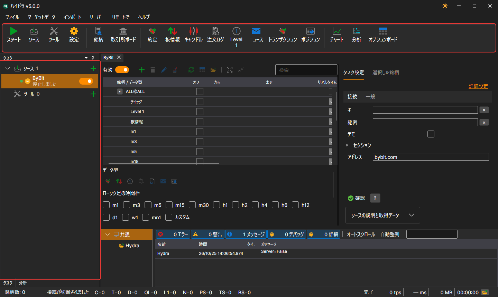
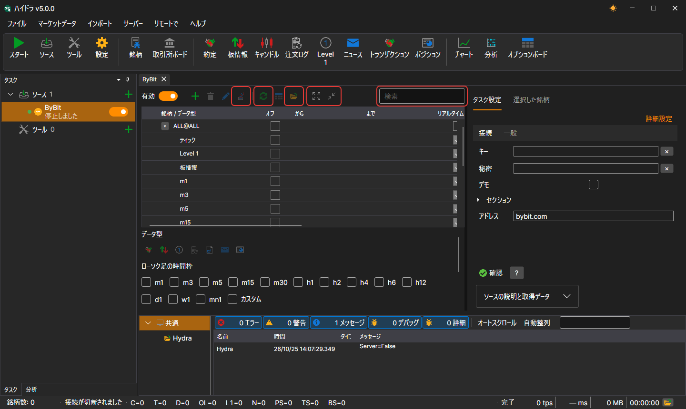

# ユーザーインターフェイス

[Hydra](../hydra.md) のウィンドウは、メニュー、その下のコマンドパネル、左側の **タスク** パネルと **分析** パネル、下部の **ログ** パネル、そして中央のドキュメント（ソース、ツール、マーケットデータのパネル）で構成されています。ウィンドウの下部にはステータスバーがあります。

## メニュー

- **ファイル** — [ソース](data_sources.md)とツールの追加、[共通設定](misc/settings.md)、[プロキシ設定](misc/network_settings.md)、[設定のリセット](misc/settings_reset.md)、および終了。
- **マーケットデータ** — ストレージのマーケットデータを表示するパネル: 銘柄、取引所ボード、約定、板情報、ローソク足、注文ログ、Level 1、ニュース、トランザクション、ポジション、さらに[チャート](working_with_data/chart.md)、分析、オプションボード。
- **インポート** — ファイルからのデータの[インポート](importing.md)、ストレージの[同期](misc/synchronization.md)とそのインデックスの作成。
- **サーバー** — [サーバーモード](server_mode/settings.md): 有効化、ネットワーク設定、ユーザー、クライアントのサブスクリプション。
- **リモートで** — Telegram ボットによる Hydra のリモート管理（[コントロールパネル](../telegram_services/control_panel.md)）と、Hydra がメッセージを送信する Telegram チャネルの一覧を表示する **チャネル** ウィンドウ。
- **ヘルプ** — テーマの切り替え、StockSharp チームへの連絡、問題の報告、ドキュメント、**プログラムについて** ウィンドウ。

macOS では、メニューはシステムのメニューバーに移動します。

## コマンドパネル

メニューの下には、よく使う操作をまとめたコマンドパネルがあります。**すべてのタスクを開始 / 停止**、ソースとツールの追加、設定、**銘柄** パネルと **取引所ボード** パネル、マーケットデータのパネル（約定、板情報、ローソク足、注文ログ、Level 1、ニュース、トランザクション、ポジション）、そして **チャート**、**分析**、**オプションボード** です。

## タスク

左側の **タスク** パネルでは、タスクが **ソース** グループと **ツール** グループに分けられています。グループには、タスクの数と、新しいタスクを追加する **+** ボタンが表示されます。各タスクには、点（タスクが有効な場合は緑色）、アイコン、名前、現在の状態を示す行、スイッチがあります。時計のアイコンは、そのタスクに作業時間が設定されていることを示します。ダブルクリックするとタスクのパネルが開き、右クリックすると **開く** と **削除** の項目を含むメニューが開きます。

ウィンドウの中央に何も開いていない間は、**ソースを追加** ボタンと **ツールを追加** ボタンのあるウェルカム画面が表示されます。

時間のかかる処理（たとえば、大きなストレージの読み込みやソースの追加）が行われている間、ウィンドウは半透明のオーバーレイで覆われ、現在行われている処理の説明が表示されます。

## タスクパネル

ソースの銘柄テーブルの上には、検索、**有効** スイッチ、銘柄の追加・削除・変更ボタン、**ALL@ を追加**（ソースのすべての銘柄を一度に追加）、日付の同期、データとストレージフォルダーへの移動、行の折りたたみと展開があります。設定タブには接続確認ボタンとソースの説明があり、**選択した銘柄** タブには、テーブルで選択した銘柄のプロパティが表示されます。

## ステータスバー

ウィンドウの下部には、ストレージ内の銘柄の数、Hydra が接続されているかどうか、起動後に受信した各種データの数、プログラムが現在行っている処理、ログの最新の警告またはエラーが表示されます。フォルダーのボタンでログフォルダーが開きます。時間のかかる処理（大きなストレージの読み込み、ソースの追加）の間は、ウィンドウが処理内容の説明付きのオーバーレイで覆われます。

## 推奨コンテンツ

[初回起動](first_start.md)

[データ ソース](data_sources.md)
