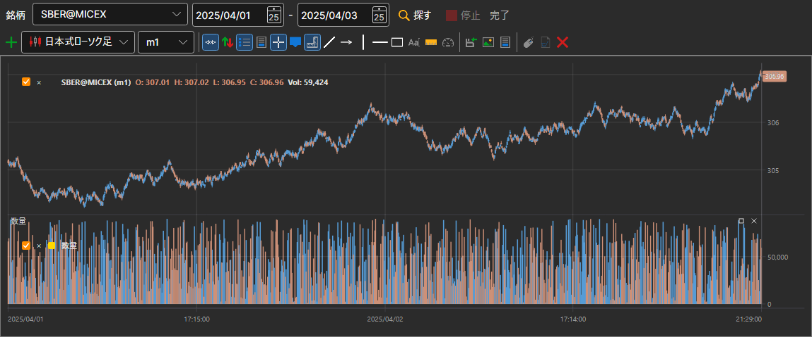

# チャート

**チャート** パネルには、ストレージにある任意の銘柄のローソク足が表示されます。このパネルは、**マーケットデータ → チャート** 項目、またはコマンドパネルの **チャート** ボタンで開きます。

チャートの上の行で、**銘柄** と期間（開始日と終了日）を選択し、**探す** をクリックします。ローソク足はストレージから読み込まれ、読み込みに合わせて描画されます。**停止** で読み込みを中断できます。ボタンの横の行には、処理の進行状況が表示されます。

その下には、[Terminal](../../terminal/user_interface/components/chart.md) と同じ本格的なチャートがあります。ボタンパネル、ローソク足のスタイル、インジケーター、描画機能を備えています。チャートには [インジケーター](view_and_export/indicators.md) を追加でき、**描画を停止** ボタンで、長い期間の時間のかかる描画を止められます。

## 推奨コンテンツ

[ローソク足の生成](candles_generation.md)

[表示とエクスポート](view_and_export.md)
