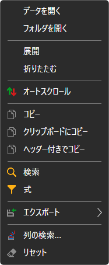
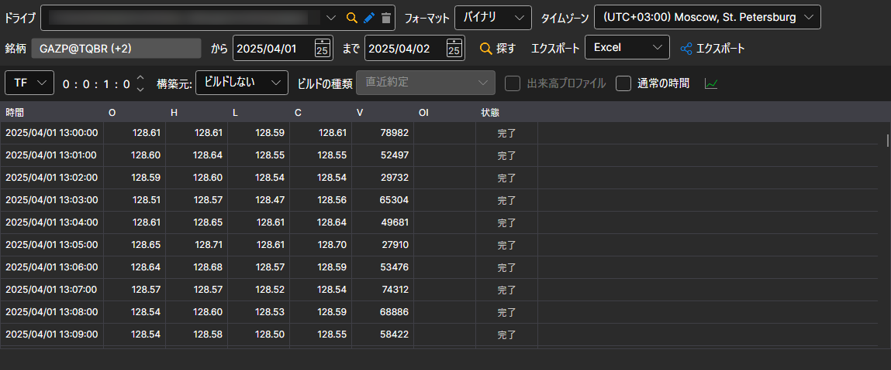
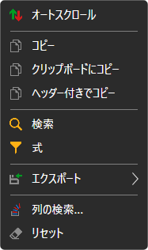

# 表示とエクスポート

受信した [Hydra](../../hydra.md) データは、専用パネルで表示できます。 

これを行うには、**マーケットデータ** メニューで次のいずれかの項目を選択します: [ティック](view_and_export/ticks.md)、[板情報](view_and_export/order_books.md)、[ローソク足の生成](candles_generation.md)、[注文ログ](view_and_export/order_log.md)、[Level 1](view_and_export/level_1_.md)、[ニュース](view_and_export/news.md)、[トランザクション](view_and_export/transactions.md)、[オプションデスク](view_and_export/option_desk.md)、[インジケーター](view_and_export/indicators.md)、[ポジション](view_and_export/positions.md)。

タスクのデータのパネルは、そのタスクの銘柄テーブルから開くこともできます。図に示すように、データ型をダブルクリックするか、コンテキストメニューの **データを開く** 項目を選択します。

各パネルには、次のような設定用の共通インターフェイスがあります。

- 上の行には、マーケットデータストレージ（**ドライブ**）、その **フォーマット**（バイナリまたは CSV）、および時刻を表示する **タイムゾーン** が示されます。
- 2 番目の行では、銘柄と、データを要求する期間を選択します。**銘柄の選択** ボタンをクリックすると銘柄選択ウィンドウが表示され、1 つまたは複数の銘柄を選択できます。複数の銘柄を選択した場合、その後 Excel または CSV へエクスポートするときに、プログラムは異なる銘柄のデータを自動的に別々のファイルへ振り分けます。
- 見つかったデータは 1,000 行ずつテーブルに読み込まれます。テーブルを最後までスクロールすると次の部分が自動的に読み込まれるため、期間全体の読み込みを待たずに、好きなだけ先へスクロールできます。列による並べ替えは読み込み済みの行を並べ替えますが、パネルのボタンによるエクスポートでは、読み込み済みの行だけでなく、選択した期間のすべてのデータが書き出されます。
- データが現在のタイムゾーンと一致しないタイムゾーンのソースから受信された場合、タイムゾーンを調整できます。構築後、データはユーザーが選択したゾーンで表示されます。 
- 一部のソースは特定のデータをダウンロードする機能を提供していないため、プログラムには[構築元](any_market_data_types.md)フィールドが用意されています。このフィールドを使用すると、ユーザーは別の種類のマーケットデータからマーケットデータを構築できます。同じ機能を使用して、既存のデータを基に、追加のダウンロードなしでマーケットデータを構築することもできます。
- 上記のパラメーターを選択した後、**探す**  ボタンをクリックします。 検索またはエクスポートの実行中は、設定行の下にその進行状況と **停止** ボタンが表示されます。エクスポートが終わると、同じ場所に、その結果を開く **ファイルを開く** または **フォルダを開く** ボタンが表示されます。

値テーブルのコンテキストメニューでは、自動スクロールの有効化、選択した行のクリップボードへのコピー、値の検索、式による行のフィルター、テーブルのファイル・クリップボード・印刷へのエクスポート、表示する列の選択、列の配置のリセットを行えます。

