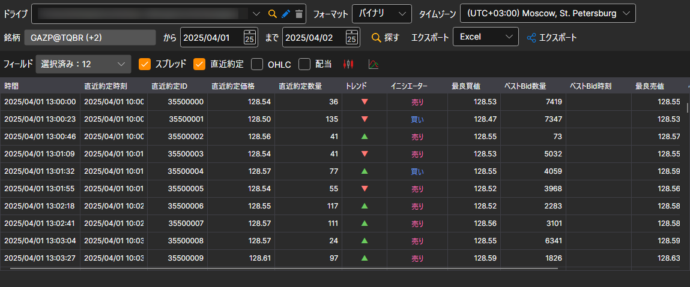
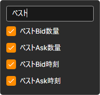

# Level 1 

表示されるウィンドウで、銘柄と必要な時間間隔を選択し、 ボタンをクリックします。

**フィールド** リストでは、テーブルに表示されエクスポートされる Level 1 の値を指定します。ドロップダウンリストで必要なフィールドにチェックを付けます。リスト上部の検索行に入力すると、名前にそのテキストを含むフィールドだけが表示されます。

取得した値は、[必要な形式にエクスポート](../export_data.md)できます。
