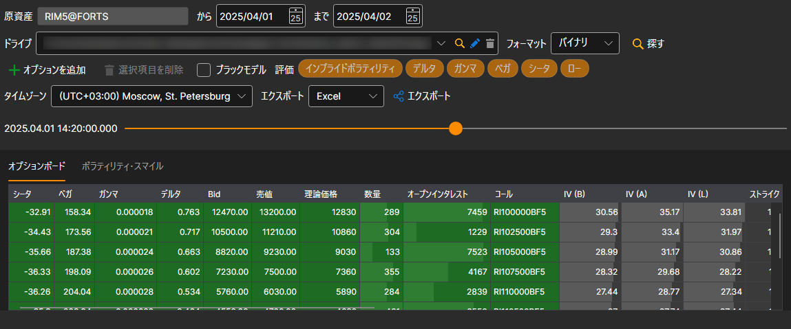
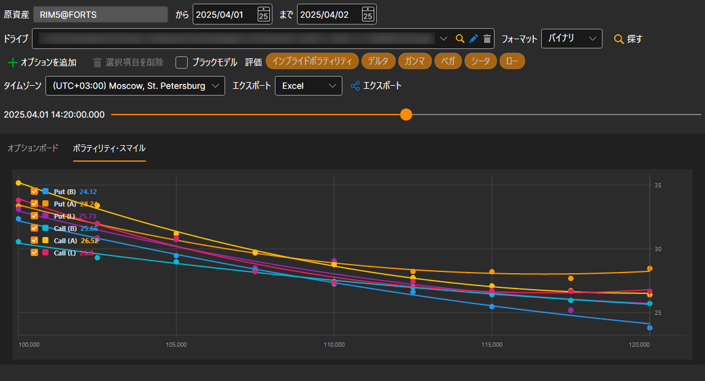

# オプションデスク

表示されるウィンドウで原資産を選択します。その原資産のオプションは自動的にボードに追加され、時間範囲はストレージにデータがある期間に設定されます。**オプションを追加** ボタンで別のオプションを追加し、**選択項目を削除** ボタンで不要なオプションを削除できます。次に、 ボタンをクリックします。

ギリシャ指標の履歴がない場合でも、スプレッドのデータがあれば、主要なギリシャ指標（Delta、Gamma、Vega、Theta、Rho、インプライド・ボラティリティ）を計算できます。これを行うには、**評価** フィールドでそれらにチェックを付けます。ボラティリティは買値、売値、最終約定価格から計算され、その他のギリシャ指標はスプレッド中央値のボラティリティから計算されます。

ボードの上のスライダーで、読み込んだ履歴の任意の時点にボードを移動できます。スライダーの左側には、その時点の時刻が表示されます。スライダーを読み込み済みの最後の時点まで動かすと、履歴の次の部分が読み込まれます。

**ボラティリティ・スマイル** を表示するには、**ボラティリティ・スマイル** タブに移動する必要があります。

計算された値は、[必要な形式にエクスポート](../export_data.md)できます。
