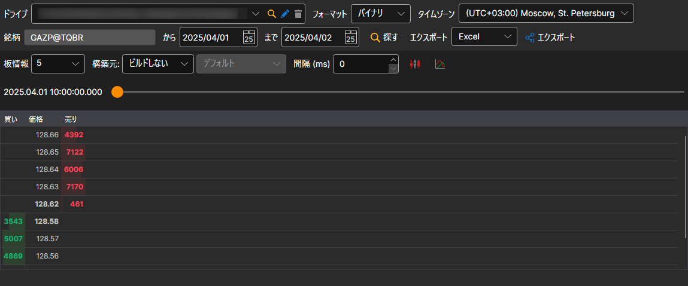

# 板情報

表示されるウィンドウで、銘柄と必要な時間間隔を選択し、 ボタンをクリックします。

スライダーで、読み込んだ板情報のうちどれを表示するかを選択します。スライダーを読み込み済みの最後の板情報まで動かすと、次の板情報が読み込まれます。

> [!TIP]
> 板情報は、[注文ログおよび Level 1 ファイル](../any_market_data_types.md)から作成できます。さらに、板情報の深さと更新周期を調整できます。

取得した値は、[必要な形式にエクスポート](../export_data.md)できます。
