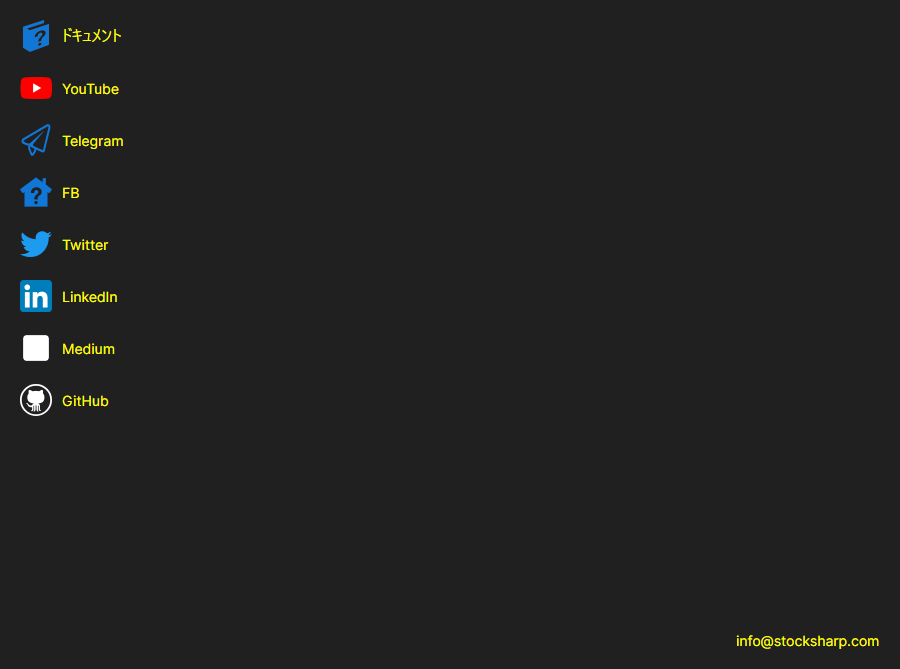

# ヘルプ

**ヘルプ** ページは、[インストーラー](../installer.md) ウィンドウ上部の同名のタブで開きます。

このページには、[インストーラー](../installer.md) からよくアクセスされるリンクがまとめられています。**ドキュメント**、**YouTube**、**Telegram**（サポートチャット）、**Twitter**、**Dzen**、**GitHub** です。リンクは、システムの既定のブラウザーで開きます。ページの下部には、会社に連絡するためのメールアドレスがあります。

問題を報告するには、ウィンドウのタイトルバーにあるボタンを使います。このボタンはどのページにもあります。[インストーラー](../installer.md) が想定どおりに動作しなかった場合は、[ログ](logs.md) ページの記録をメッセージに添付してください。それを見れば、何が起きていたのかがわかります。

## おすすめコンテンツ

[ログ](logs.md)
