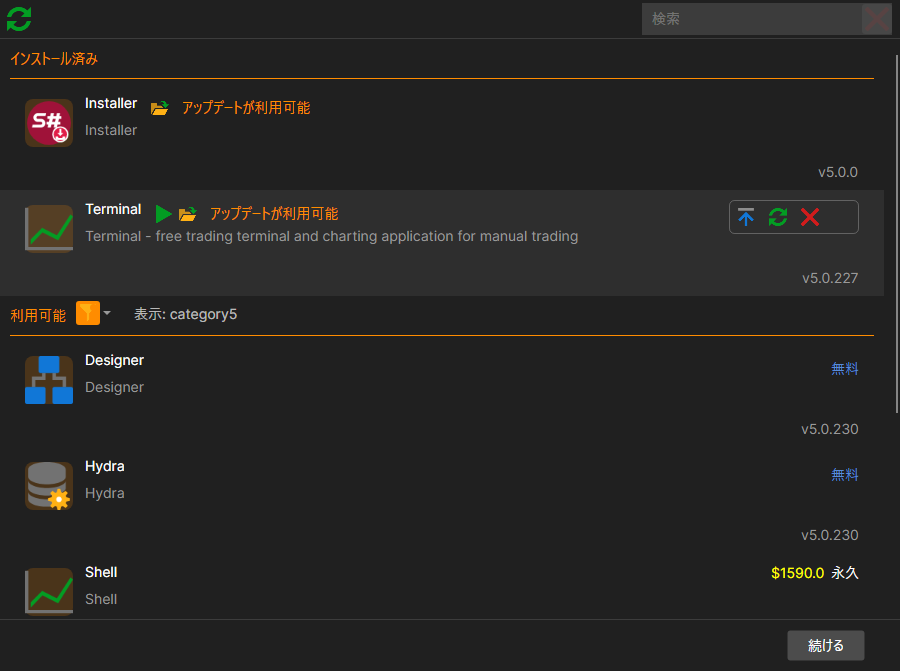
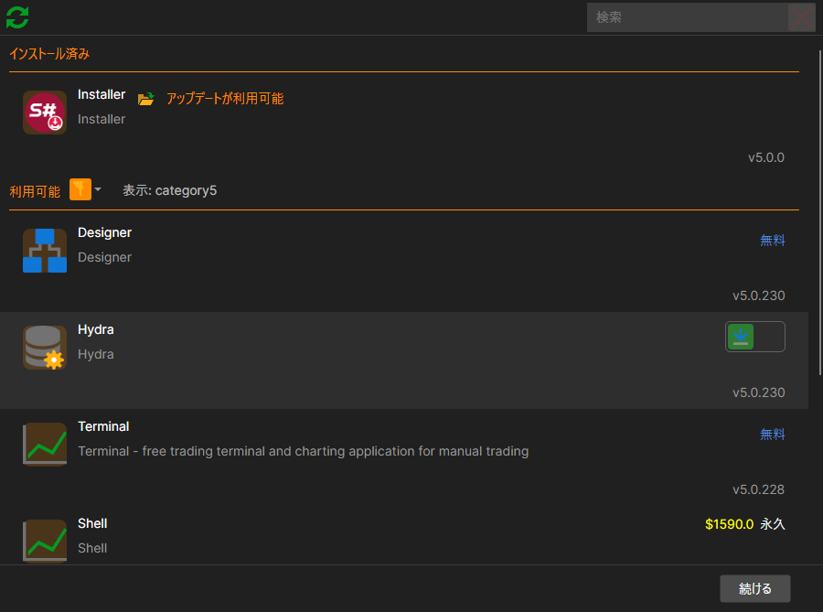
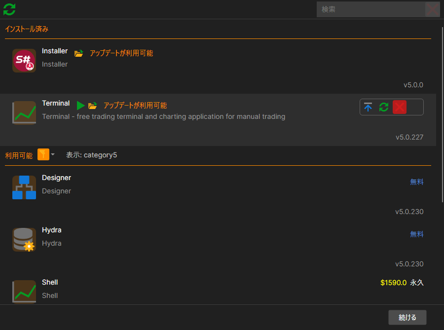
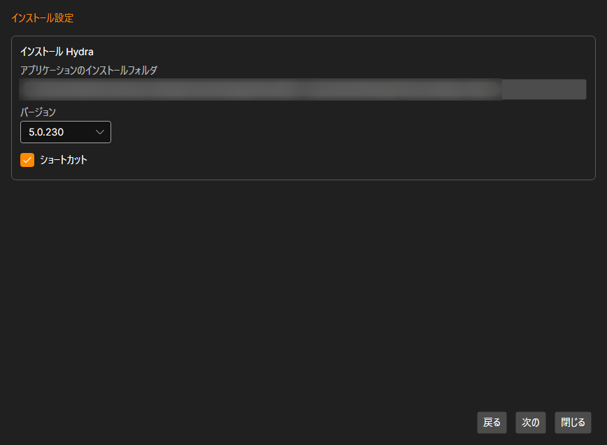

# アプリのインストールと削除

[インストーラー](../installer.md) がプログラムに対して行う操作（インストール、更新、修復、削除）は、すべて **アプリケーション** タブで行います。一覧の製品ごとに操作を指定し、指定したすべての操作をまとめて実行します。

## カタログ

一覧は 2 つの部分に分かれています。**インストール済み** はこのコンピューターにすでにインストールされているもの、**利用可能** はインストールできるものです。その部分に何もない場合は、代わりに **空の** と表示されます。

目的の製品を見つけるには、次の機能を使います。

- 一覧の上の **検索** フィールド — 入力するにつれて一覧が絞り込まれ、横のバツ印で一覧全体に戻ります。
- **利用可能** の見出しにある漏斗アイコン — 製品の種類によるフィルターです。**すべて** ボタンでフィルターを解除します。
- 左上の円形の矢印ボタン — **強制的なアップデートチェック**: 次回の定期チェックを待たずに、新しいものが出ていないかストアに問い合わせます。

インストール済みの製品の行にはそのバージョンが表示され、新しいバージョンが出ている場合は **アップデートが利用可能** と表示されます。

## ライセンス契約

ウィンドウの下部には、同意のチェックボックスと契約書へのリンクがあります。契約に同意するまでは、何を選択していても **続ける** ボタンは使用できません。同意は一度だけ、サーバー側で受け付けられます。その後、チェックボックスは表示されなくなり、同意を取り消すことはできません。

## 製品に対する操作

各行の右側にはボタンのセットがあり、そのうち 1 つを選択します。どのボタンがあるかは製品によって異なります。

| ボタン | 使用できるとき | 動作 |
|---|---|---|
| **インストール** | 製品がインストールされていない | インストールします |
| **更新** | インストール済みで、新しいバージョンが出ている | 更新します |
| **修復** | インストール済み | 設定はそのままで、上書きで再インストールします |
| **削除** | インストール済み | 削除します |
| **スキップ** | 常に | この製品には何もしません |

インストールされていない製品で選べるのは、インストールだけです。

インストール済みの製品では、修復を選べます。

削除も選べます。

右下の **続ける** ボタンは、少なくとも 1 つの操作を選択すると使用できるようになります。複数の製品の操作を同時に選択することもできます。たとえば、ある製品を更新し、別の製品を削除できます。すべて選択したら、右下の **続ける** をクリックします。

## ウィザード

続いて、ウィンドウには一覧の代わりに 3 つのステップのウィザードが表示されます。

1. **アプリケーション** — 実行される内容です。一覧を確認して **続ける** をクリックします。
2. **インストール設定** 

   操作ごとに、ここで次の設定を行います。

   - **アプリケーションのインストールフォルダ** — ボタンで選択します。**重要\!** フォルダーは空でなければなりません。
   - **バージョン** と **受信者** — どのバージョンを誰のためにインストールするか。
   - **ショートカット** — デスクトップにショートカットを作成します。
   - **ダウンロード済みデータと設定をすべて含むアプリケーションデータフォルダーを削除します。** — 削除する場合のみ: プログラムと一緒に、その設定とダウンロード済みデータも削除します。このチェックボックスをオンにしない場合、それらは残ります。
   - **プラグイン** — プラグインに対応したプログラムで、製品と一緒にどのコネクターをインストールするか。
   - **インストール 主なアプリケーションパラメータ** — プラグインのある製品では、このチェックボックスをオフにして、プログラム本体には手を付けずにプラグインだけを扱うことができます。

   **次の** をクリックします。
3. **次のアクションが実行されます** — 最後の確認です。**実行する** をクリックします。

処理中は **お待ちください...** と表示され、終わると **完了** と表示されます。**閉じる** ボタンで一覧に戻ります。どのステップでも **戻る** で前のステップに戻れます。

うまくいかなかった場合は、エラーのテキストがウィザードに直接表示され、詳細は [ログ](logs.md) ページで確認できます。

**[ビデオチュートリアル](videos/install_and_remove_apps.md)を見る**

## おすすめコンテンツ

[アプリの更新](update_apps.md)

[ログ](logs.md)
