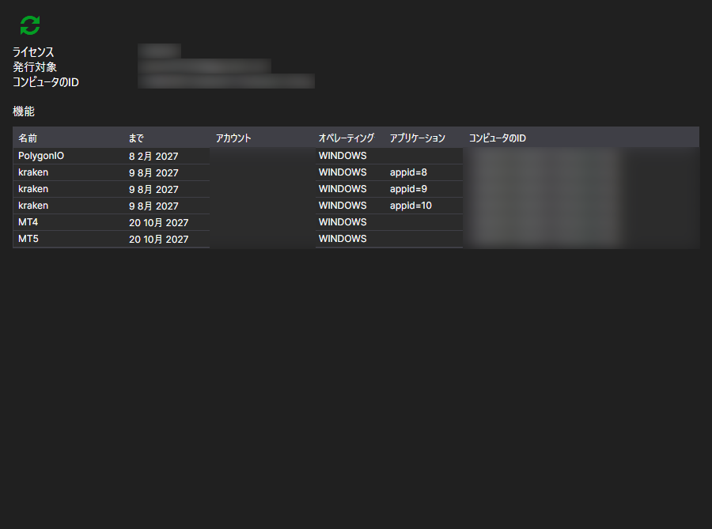

# ライセンス

**ライセンス** ページは、[インストーラー](../installer.md) ウィンドウ上部の同名のタブで開き、アカウントにサインインした後に使用できます。

ここでは、このアカウントに発行されたライセンスと、それによって何が許可されているかを確認できます。

- **発行対象** — ライセンスの名義と、ライセンスが紐付けられているコンピューター（**コンピュータのID** と **オペレーティングシステム**）。サーバーはこの紐付けによって、現在のマシンでライセンスが有効かどうかを判断します。
- 有効期限（**まで**） — ライセンスの終了日。
- **アプリケーション** — ライセンスの対象となるプログラム。
- **機能** — 具体的に許可されている内容: 取引所への接続、銘柄の数、ソースコードへのアクセスなど。

**ライセンスを更新** ボタンは、サーバーからデータを再取得します。購入または延長の後に押すと効果があります。[インストーラー](../installer.md) はサインイン時にライセンスを読み込むため、後からサイトで行った変更はウィンドウに自動的には反映されません。

ライセンスがない場合は、ページにその旨が表示されます。ライセンスは [料金プラン](tariffs.md) ページで取得できます。

## おすすめコンテンツ

[料金プラン](tariffs.md)
