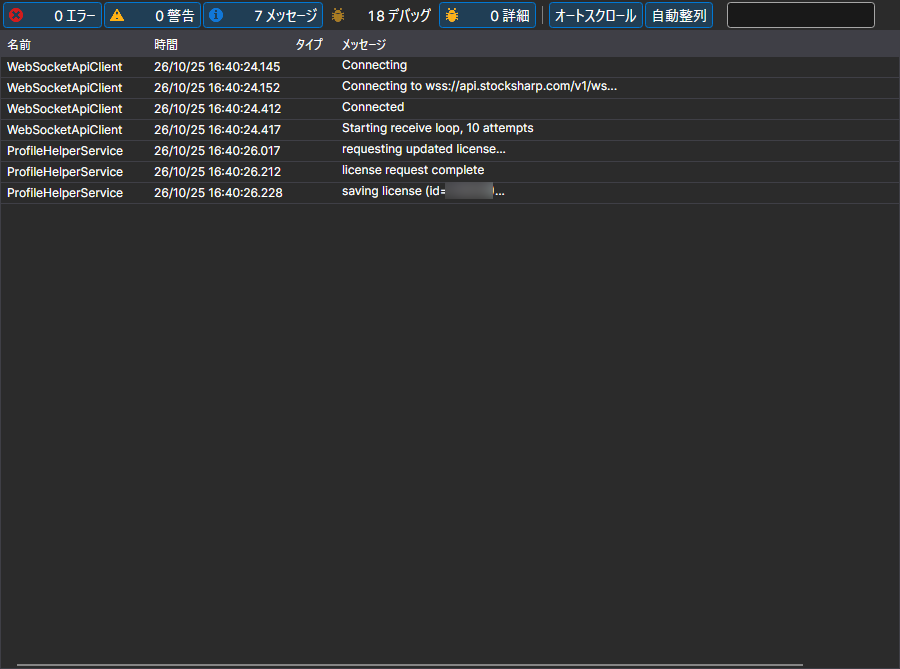

# ログ

**ログ** ページは、[インストーラー](../installer.md) ウィンドウ上部の同名のタブで開きます。

ここには、[インストーラー](../installer.md) が行った処理が記録されます。どのサーバーにアクセスしたか、どのパッケージをダウンロードしたか、どこにインストールしたか、どこで止まったかです。インストールや更新がエラーで終わった場合は、まずここを確認してください。

各記録には、時刻、レベル（エラー、警告、メッセージ）、テキストが含まれます。ログの詳しさは、[設定](settings.md) ページの **ログ記録** パラメーターで指定します。サポートに問い合わせる際は、このレベルを上げて、うまくいかなかった操作をもう一度実行してください。そうすれば、エラーが起きたという事実だけでなく、その原因もログに残ります。

## おすすめコンテンツ

[設定](settings.md)
