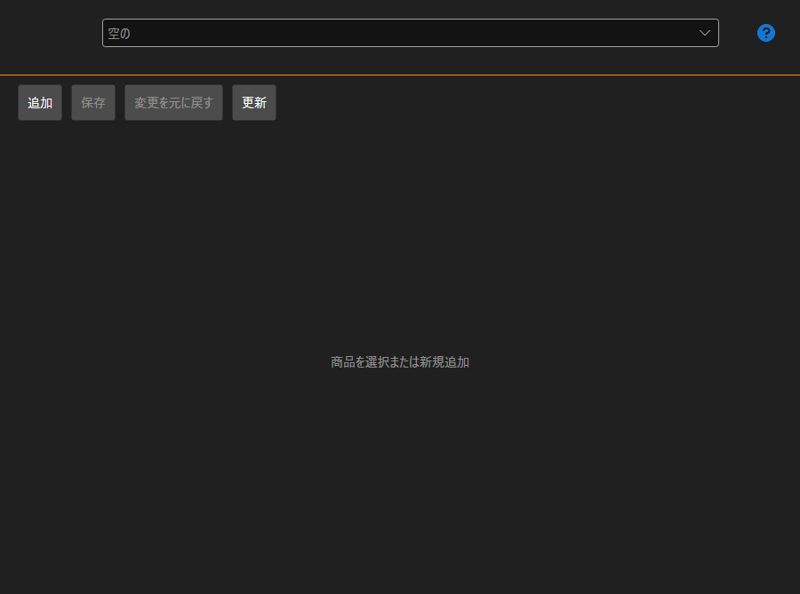

# 私の製品

**私の製品** ページは、[インストーラー](../installer.md) ウィンドウ上部の同名のタブで開き、アカウントにサインインした後に使用できます。

このページは、[ストア](https://stocksharp.com/ja/store/) で自分の製品（ロボット、インジケーター、コネクター）を公開するユーザー向けです。購入者には必要ありません。インストールと更新については、[アプリのインストールと削除](install_and_remove_apps.md) と [アプリの更新](update_apps.md) で説明しています。

## 製品カード

製品は上部の一覧で選択します。**追加** ボタンで新しい製品を作成します。

- **名前** と **説明** — 購入者がストアで目にする内容。
- **NugetパッケージID** — この名前でパッケージが NuGet に公開されます。その横に、完全な名前がどのようになるかが表示されます。
- **コンテンツタイプ** と **エリア** — どのような製品で、どこで使われるか。
- **カテゴリー** — 製品が表示されるストアのセクション。
- **リンク**（ドキュメントへのリンク）と **ソースコード**（ソースコードへのリンク） — どちらも任意です。
- **アイコン** — ボタンで選択します。購入者の [インストーラー](../installer.md) の一覧にも、このアイコンが表示されます。

## 価格

価格は個別に設定します。1 回限りの価格（**永久**）、**月々**、**年次**、さらに **更新価格** です。価格を入力しない場合、その購入方法は提供されません。

## アクセス

ユーザーの一覧では、ストア以外で製品を閲覧できるユーザーを指定します。検索でユーザーを見つけて追加します。これにより、たとえばチーム内でアクセスを共有できます。

## 保存と公開

**保存** で変更を書き込み、**変更を元に戻す** で最後に保存した状態に戻し、**更新** でサーバーから一覧を再読み込みします。

**公開する** をクリックすると、製品が審査に送られます。審査に通るまでは、製品がまだ承認されていないことがページに表示され、下部のエラー一覧に、入力または修正が必要な項目が示されます。この一覧が空になるまで、公開はできません。

## おすすめコンテンツ

[ライセンス](licenses.md)
