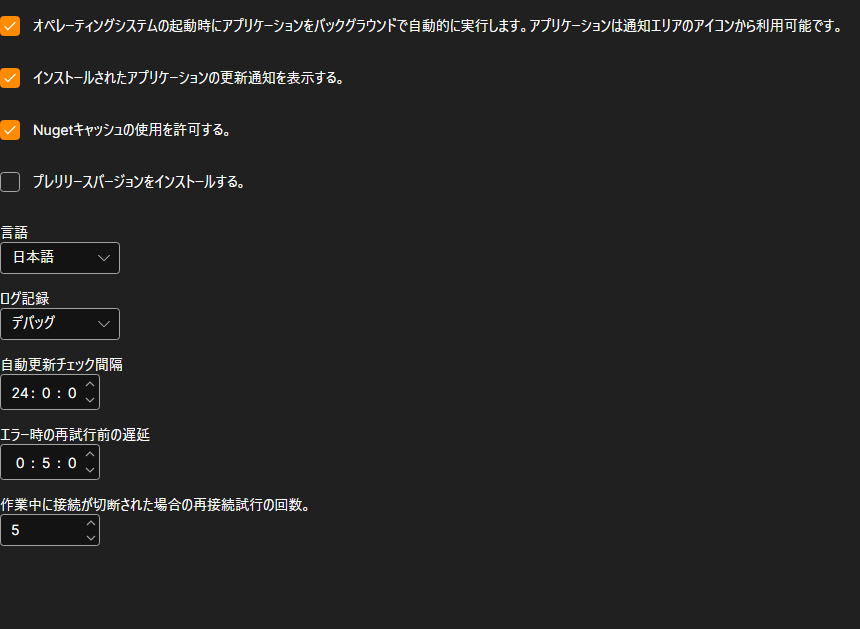

# 設定

**設定** ページは、[インストーラー](../installer.md) ウィンドウ上部の同名のタブで開きます。

## 変更できる項目

- **オペレーティングシステムの起動時にアプリケーションをバックグラウンドで自動的に実行します。** [インストーラー](../installer.md) は Windows と一緒に起動し、通知領域に常駐します。終了するときもそこから行います。ウィンドウのバツ印ではプログラムは終了しません。
- **インストールされたアプリケーションの更新通知を表示する。** このチェックボックスをオフにしても、[インストーラー](../installer.md) は更新の確認を続けますが、通知はしません。更新があるかどうかは、アプリケーションのページでしか確認できません。表示の例については、[アプリの更新](update_apps.md) を参照してください。
- **Nugetキャッシュの使用を許可する。** このマシンにすでにダウンロードされているパッケージは、ネットワークではなくディスクから取得されます。再インストールが速くなります。パッケージを確実に取得し直したい場合はオフにします。
- **プレリリースバージョンをインストールする。** 通常のリリースに加えて、プレビュービルドも提示されます。まだリリースされていないバージョンがなぜ必要なのかがわかっている場合にだけ、オンにしてください。
- **言語。** [インストーラー](../installer.md) 自体のインターフェイスの言語。
- **ログ記録。** ログをどの程度詳しく書き込むか。記録は [ログ](logs.md) ページで確認できます。サポートに問い合わせる際は、詳しいレベルにしておくと原因を早く見つけられます。
- **自動更新チェック間隔。** [インストーラー](../installer.md) がサーバーに新しいバージョンを問い合わせる頻度（時間単位）。
- **エラー時の再試行前の遅延。** 失敗したダウンロードを再試行するまでの待ち時間（分単位）。
- **作業中に接続が切断された場合の再接続試行の回数。** [インストーラー](../installer.md) がエラーを報告するまでに、パッケージのダウンロードを再試行する回数。

変更はすぐに適用されて保存されます。保存用のボタンはありません。

## おすすめコンテンツ

[ログ](logs.md)
