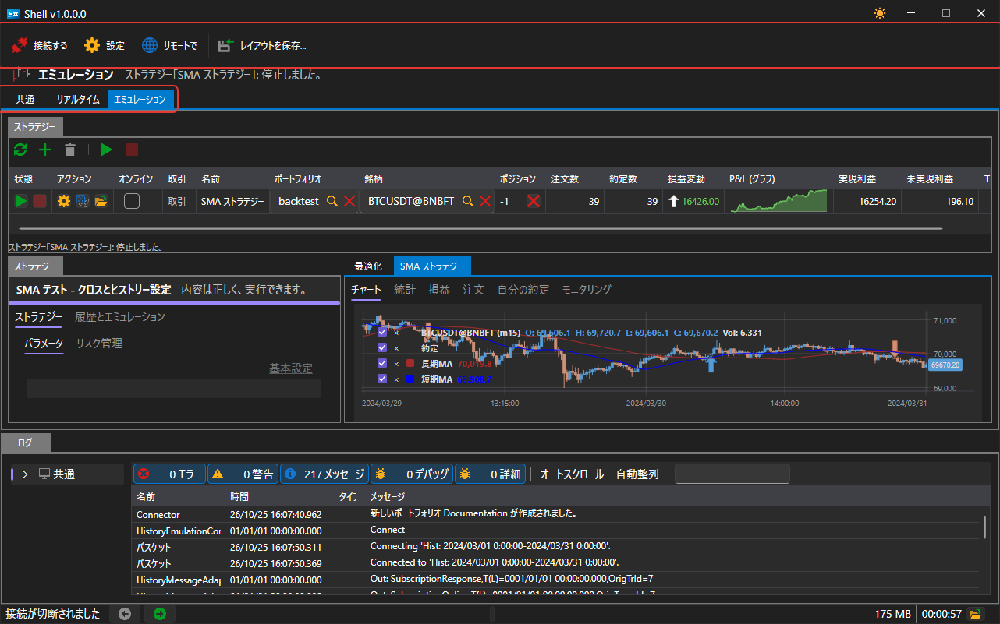
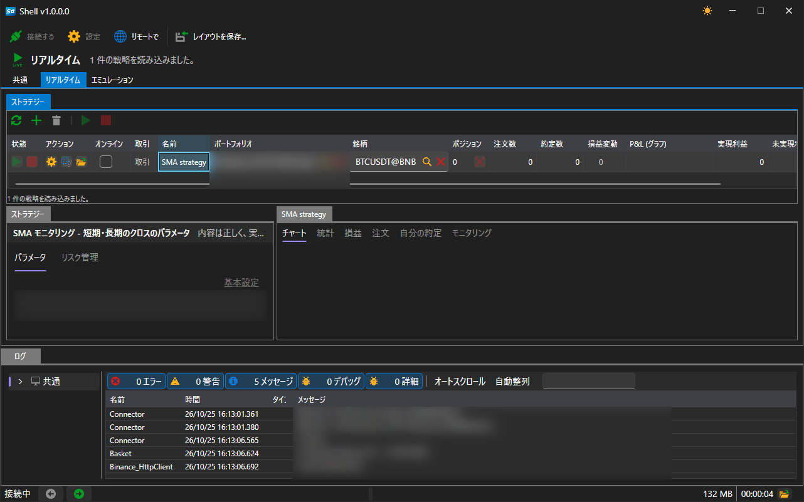
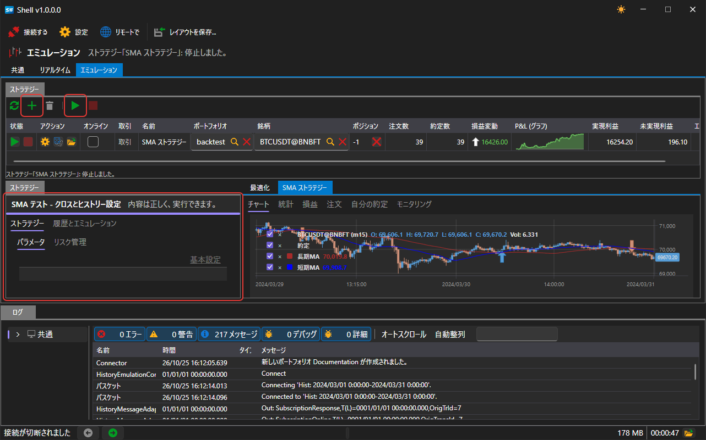

# クイックスタート

[Shell](../shell.md) は [C#](https://en.wikipedia.org/wiki/C_Sharp_(programming_language)) のソースコードで、Visual Studio、Rider、またはその他の環境で開き、通常のアプリケーションとして実行します。

```
dotnet run --project Shell.Avalonia/Shell.Avalonia/Shell.Avalonia.csproj
```

事前の設定は不要です。プロジェクトはそのまま起動し、付属のストラテジーですぐに動作します。

## メインウィンドウ

起動すると、次のようなウィンドウが開きます。



左側には、アプリケーションで切り替える作業領域の一覧があります。上部はコマンドバーで、接続設定ボタン、**接続する** ボタン、現在のパネルレイアウトの保存があります。下部は、現在の接続状態を示すステータスバーです。

Shell が書き込むもの（接続設定、ウィンドウのレイアウト、ストラテジーの一覧、インポートした Designer のスキーム、気配値のローカルストレージ）は、すべて実行ファイルの隣にある `Data` フォルダーに保存されます。

## 接続

接続設定に移動し、必要なコネクターを選択します。接続の設定方法は、[接続設定](connections_settings.md)で説明しています。

次に、**接続する** をクリックします。接続状態は、ステータスバーとボタンの横に表示されます。

接続後、[共通](user_interface/common.md) タブに、接続から受信したポートフォリオ、銘柄、注文、および自己約定が表示されます。


## 取引でのストラテジー

[リアルタイム](user_interface/real_time.md) タブに移動します。



**追加** をクリックし、開いたウィンドウでストラテジーを選択します。


ストラテジーは **ストラテジー** テーブルに表示され、そのパラメーターは左側の **ストラテジー** パネルに表示されます。**銘柄**、**ポートフォリオ**、数量、およびストラテジー自体のパラメーターを入力して、**スタート** をクリックします。

接続が確立されるまで、この領域の追加ボタンと開始ボタンは使用できません。そのことは、テーブルの下のヒントに示されます。

## 履歴でのストラテジー

[エミュレーション](user_interface/emulation.md) タブで同じ操作を行うと、ストラテジーは取引ではなく履歴データで実行されます。



これには接続は必要ありません。各実行は、独自のエミュレーションコネクターを通じてディスクから履歴を読み込みます。

## 推奨コンテンツ

[共通](user_interface/common.md)

[リアルタイム](user_interface/real_time.md)

[エミュレーション](user_interface/emulation.md)
