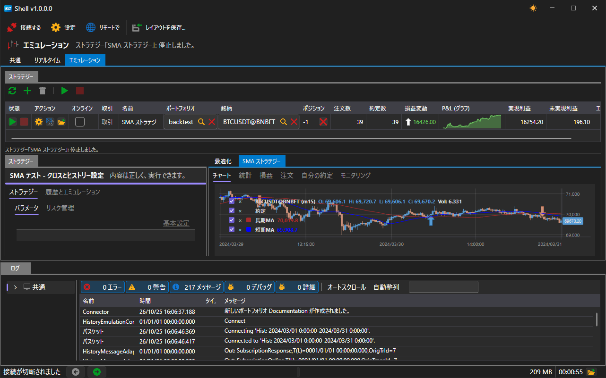

# リモート管理

[Shell](../shell.md) は、自分のストラテジーをサイトからの管理に任せることができます。実行中のプログラムはアカウントのアプリケーションとして登録され、各ストラテジーの状態をサイトに通知し、サイトから届くコマンドを実行します。[Hydra](../hydra.md) と [Designer](../designer.md) のリモート管理も同じ仕組みのため、[Telegram ボット](../telegram_services/control_panel.md) のプログラムの一覧と管理ボタンは、3 つのプログラムすべてで同じように表示されます。

## 有効化

メインウィンドウのコマンドバーに **リモートで** スイッチがあります。

スイッチがオフの間、[Shell](../shell.md) はどこにも接続せず、サイトにも表示されません。オンの状態は記憶され、次回プログラムを起動したときに復元されます。

スイッチが機能するのは、プログラムが StockSharp アカウントで起動しており、サイトにアクセスできる場合だけです。アカウントにサインインしていない場合、オンにしても何も起こりません。接続は開かれず、アプリケーションはサイトに登録されません。

## リモートで利用できるもの

リモートで利用できるのは、[エミュレーション](user_interface/emulation.md) 領域のストラテジー、つまり履歴で動作するストラテジーです。[リアルタイム](user_interface/real_time.md) 領域のストラテジーは意図的に利用できないようになっています。これらは実際の資金で取引するため、そのようなストラテジーを起動できるのはコンピューターの前にいる人だけです。スクリプトが使用するプロセス間通信のプロトコルにも、同じ境界があります。

個々のストラテジーは自動的にはサイトに表示されず、その設定で許可されている場合にのみ表示されます。[エミュレーション](user_interface/emulation.md) 領域でストラテジーを開き、その設定で **リモートで** グループを見つけます。

| 設定 | 指定する内容 |
|---|---|
| **有効** | サイトがこのストラテジーを表示し、管理できるかどうか |
| **通知** | ストラテジーのメッセージの送信先チャネル。チャネルを選択しない場合はアカウントのチャネル |
| **ログレベル** | どのレベル以上のメッセージをチャネルに送信するか |

チャネルはアカウントから取得されるため、一覧はサインイン後に表示されます。[Telegram](../telegram_services.md) のチャネルの設定については、[認可](../telegram_services/authorization.md) セクションで説明しています。

## コマンド

サイトやボットからは、プログラム全体に関するコマンドと、個々のストラテジーに関するコマンドの 2 種類が届きます。

| コマンド | 動作 |
|---|---|
| ストラテジーの **スタート** | 実行が停止している場合、またはエラーで終了した場合に、実行を開始します |
| ストラテジーの **停止** | 動作中の実行を停止します |
| ストラテジーを指定しない **スタート** / **停止** | リモート管理が許可されているすべてのストラテジーに対して、同じ操作を一度に行います |
| 取引の **有効化** / **無効化** | ストラテジーを完全な取引モードにするか、取引を禁止します。現在の実行にはすぐに反映されます |
| プログラムの **停止** | [Shell](../shell.md) を閉じます |
| プログラムの **再起動** | [Shell](../shell.md) を閉じて、再び起動します |

リモート管理が許可されていないストラテジー宛てのコマンドは無視されます。

## サイトに送られるもの

- プログラム自体の状態: ウィンドウが開いている間は起動中、閉じると停止。
- 許可された各ストラテジーの状態（変化するたびに）。
- 選択したレベル以上のストラテジーのメッセージ（選択したチャネルへ）。同じメッセージは繰り返し送信されません。

## 推奨コンテンツ

[コントロールパネル](../telegram_services/control_panel.md)

[エミュレーション](user_interface/emulation.md)
