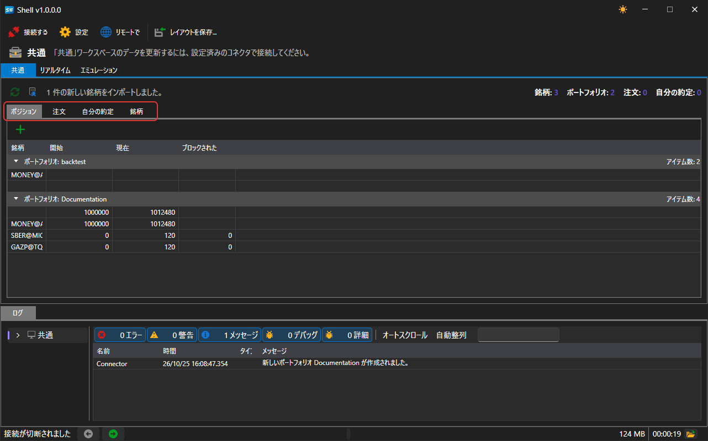

# 共通

**共通** タブには、接続から届いたもの（ポートフォリオ、ポジション、注文、自己約定、銘柄）が表示されます。

この領域は個別のパネルで構成されています。どのパネルも、タイトルをドラッグして別の場所へ移動したり、領域を縦または横に分割したり、別ウィンドウに切り離して元に戻したりできます。レイアウトはコマンドバーの **レイアウトを保存...** ボタンで保存され、次回の起動時に復元されます。

| パネル | 表示内容 |
|---|---|
| **ポートフォリオ** | ポートフォリオとそのポジション |
| **注文** | 注文と登録の拒否 |
| **自分の約定** | 自己約定 |
| **銘柄** | 接続が認識している銘柄、またはローカルストレージから読み込んだ銘柄 |

接続が確立されるまで、パネルは空のままで、ウィンドウ下部のステータスバーには、接続が必要であることを示すヒントが表示されます。

コマンドバーの右側には、現在この領域にある銘柄、ポートフォリオ、注文、約定の数が表示されます。

コマンドバーの銘柄アイコンのボタンは、履歴フォルダーから銘柄を追加します。フォルダーを尋ね、そこで見つかった銘柄を銘柄ディレクトリに登録し、ボタンの横に追加された数を表示します。テーブルに表示されるのは接続後です。この領域のパネルは、接続から届くものを表示するためです。

## 推奨コンテンツ

[リアルタイム](real_time.md)

[ログ](log.md)
