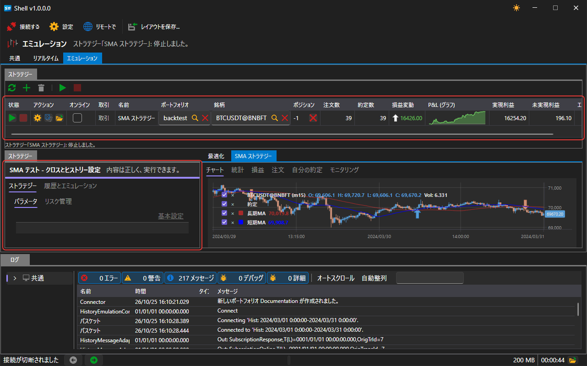
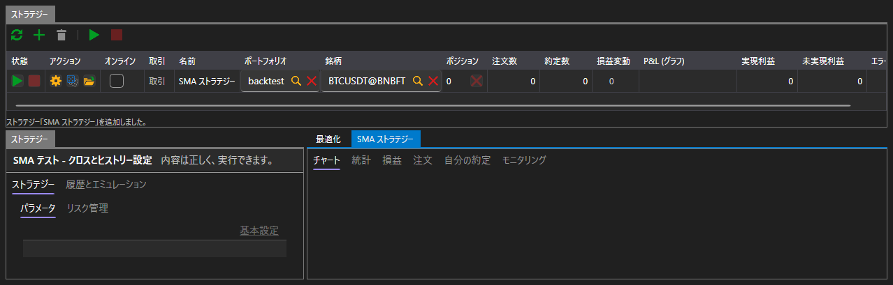
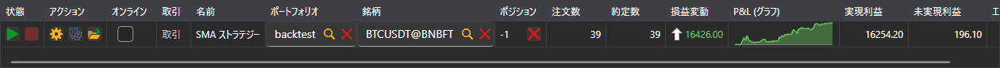
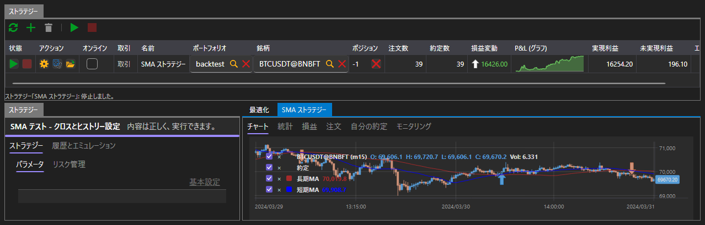
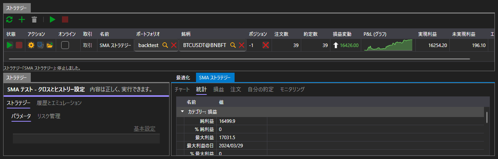
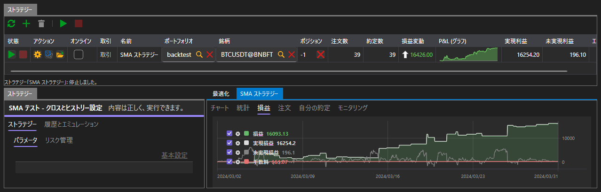
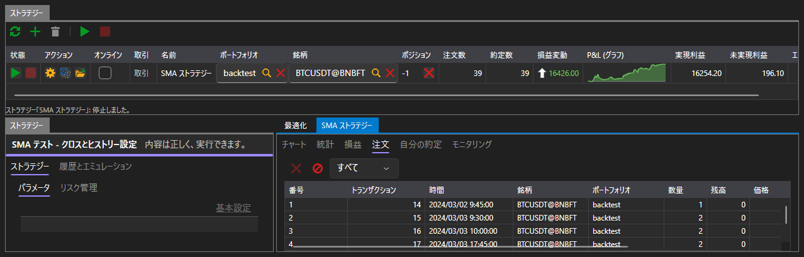
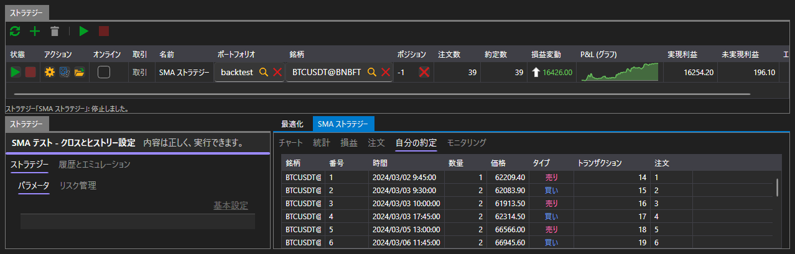

# エミュレーション

**エミュレーション** タブでは、ストラテジーを履歴データで実行します。これには接続は必要ありません。各実行は、独自のエミュレーションコネクターを通じてディスクから履歴を読み込みます。

この領域は [リアルタイム](real_time.md) と同じ構成です。上部にボタン付きの **ストラテジー** テーブル、左側に選択したストラテジーのパネル、右側に実行で生成されたすべてのものを表示するタブがあります。違いは、ストラテジーのパネルにある 2 つのタブと、結果の中にある **最適化** タブです。

## 実行のパラメーター

左側は **ストラテジー** パネルで、ストラテジーが履歴で使うすべてのものを指定します。このパネルには 2 つのタブがあります。

- **ストラテジー** — 銘柄、ポートフォリオ、数量、リスクルール、ストラテジー独自のパラメーター。
- **履歴とエミュレーション** — データの取得元と、データをストラテジーに渡す方法。

| パラメーター | 指定する内容 |
|---|---|
| **ヒストリーのパス** | 実行時にローソク足とティックを読み込むフォルダー |
| **から**、**まで** | 実行の最初の日と最後の日 |
| **ストレージ形式** | ディスク上の履歴の形式 |
| **タッチ時にマッチ** | 価格が通過するのを待たず、価格に触れた時点で注文を約定させます |
| **取引セッションの状態** | 取引所が取引していない間は注文を拒否します |
| **レイテンシー** | 注文の送信から取引所が受け取るまでの遅延（ミリ秒） |

既定では、プラットフォームと一緒にインストールされる履歴と、その履歴がカバーする期間が設定されています。つまり、何も変更せずに最初の実行を開始できます。

パラメーターが正しく入力されていない場合（パスが指定されていない、期間の終了が開始より前、遅延が負の値など）、テーブルの下にそのことを示すメッセージが表示され、実行は開始されません。

## 実行

**スタート** ボタンで実行が始まり、パネルのタイトルの下のバーに進行状況が表示されます。実行は履歴の終わりで自動的に終了します。**キャンセル** ボタンで途中で停止できます。

実行中も実行後も、ストラテジーのテーブルには取引の場合と同じ内容（状態、ポジション、注文数と約定数、損益）が表示されます。

## 結果

右側には、実行で生成されたすべてのものを切り替えて表示するタブがあります。

| タブ | 表示内容 |
|---|---|
| **チャート** | 銘柄のローソク足と、その上のストラテジーの約定 |
| **統計** | プラットフォームが計算するすべての指標 |
| **損益** | 収益曲線 |
| **注文** | ストラテジーが発注したすべての注文 |
| **自分の約定** | ストラテジーで成立したすべての約定 |
| **最適化** | [パラメーターの総当たり](optimization.md) |

### チャート

チャートには、実行に使われた銘柄のローソク足と、その上にストラテジーの約定のマークが表示されます。

### 統計

統計は、損益、約定、注文、遅延のセクションに分けられています。特に、純利益、金額とパーセントでの最大ドローダウン、利益の出た約定と損失の出た約定の数、約定あたりの平均利益、プロフィットファクター、シャープ・レシオ、ソルティノ・レシオ、カルマー・レシオ、スターリング・レシオが表示されます。

統計の約定数は、ストラテジーのテーブルの約定数より少なくなります。統計が数えるのは何かをクローズした約定で、最初のポジションを開いた約定は含まれないからです。

### 損益

収益曲線は、実行中にストラテジーの結果がどのように変化したかを示します。

### 注文と約定

**注文** タブには、ストラテジーが発注したすべてのもの（各注文の時刻、方向、種類、数量、価格、状態）が表示されます。

**自分の約定** タブには、それらの注文のうち約定したものが表示されます。

## 推奨コンテンツ

[最適化](optimization.md)

[リアルタイム](real_time.md)
