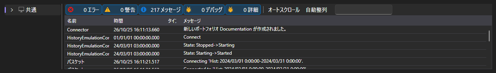

# ログ

**ログ** タブには、アプリケーションが自分の動作について通知するすべてのもの（接続、ストラテジー、エミュレーション、シェル自体のメッセージ）が表示されます。

各記録は、時刻、レベル（デバッグ、情報、警告、エラー）、ソース、テキストで構成されます。ストラテジーの記録にはストラテジーの識別子が付いているため、複数のストラテジーが同時に動作していても、どのストラテジーのメッセージかがわかります。

テーブルの上には、蓄積されたエラーと警告の数と、ログをクリアするボタンが表示されます。テーブル自体では、レベルによる記録のフィルター、テキストによる検索、列の選択、内容のエクスポートができます。

ストラテジーが起動しない、注文を出さない、または履歴での実行が開始直後に終了する場合は、まずログを確認してください。

## 推奨コンテンツ

[共通](common.md)
