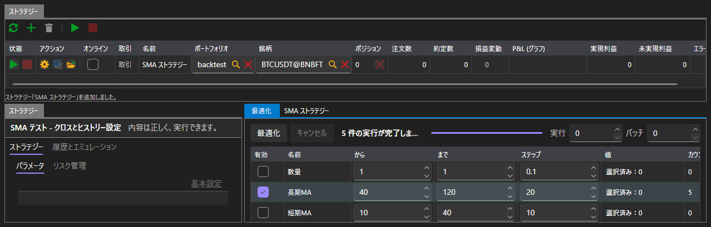

# 最適化

**最適化** タブは、総当たりでストラテジーのパラメーターを選びます。同じストラテジーを同じ履歴で、パラメーターの組み合わせの数だけ実行し、各実行の結果を表示します。

最適化は [エミュレーション](emulation.md) 領域でのみ使用できます。[リアルタイム](real_time.md) にはこのタブはありません。ライブ接続でパラメーターを総当たりする方法はないからです。

## 総当たりの対象

パラメーターのテーブルには、選択したストラテジーのうち総当たりできるパラメーターが一覧表示されます。パラメーターが総当たりに参加するのはチェックを付けた場合だけで、チェックを付けたパラメーターには開始、終了、ステップを指定します。入力できる内容はパラメーターの型によって異なります。整数型なら整数値、ブール型なら 2 つの値だけです。

ボタンの右側で、総当たりの範囲を指定します。

| フィールド | 指定する内容 |
|---|---|
| **実行** | 最大の実行回数。0 は無制限 |
| **バッチ** | 同時に実行する回数 |

組み合わせの数はパラメーターにチェックを付けるたびに再計算されるため、総当たりの規模を事前に確認できます。

## 総当たりの進行

**最適化** ボタンで総当たりが始まり、**キャンセル** で停止します。ステータス行には、何が起きているか（総当たりの計画中、何回分の実行中、何回の実行後に総当たりを停止した、総当たりで実行が 1 回もなかった）が表示されます。その横のバーには進行状況が表示されます。

## 結果

結果は、次の 3 つの方法で同時に表示されます。

- 各行が 1 回の実行で、そのパラメーター値、最終的な利益、収益曲線を含むテーブル。
- 選択した 2 つのパラメーターによるサーフェス。
- 同じサーフェスをヒートマップとして表示したもの。

テーブルで行を選択すると、その実行の収益曲線が表示されます。

## 推奨コンテンツ

[エミュレーション](emulation.md)
