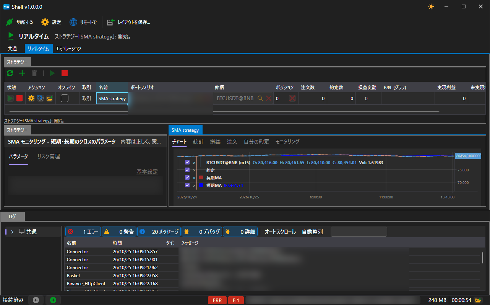
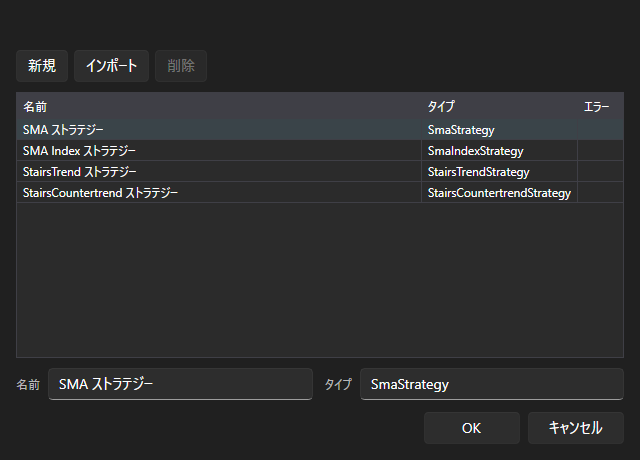

# リアルタイム

**リアルタイム** タブでは、ライブ取引で実行中のストラテジーを管理します。

この領域は 3 つの部分で構成されています。

- **ストラテジー**（テーブル） — 上部にある、この領域のすべてのストラテジーのテーブルと、それらを管理するボタン。
- **ストラテジー**（パネル） — 左側にある、選択したストラテジーのパラメーター。
- 右側のタブ（**チャート**、**統計**、**損益**、**注文**、**自分の約定**） — 選択したストラテジーが表示し、発注し、約定させたもののすべて。

この領域を使えるのは、接続が確立されている場合だけです。接続がない場合、ボタンは使用できず、テーブルの下にそのことを示すヒントが表示されます。

## ボタン

| ボタン | 動作 |
|---|---|
| **更新** | ストラテジーの一覧を再読み込みします |
| **追加** | ストラテジーの選択ウィンドウを開きます |
| **削除** | 選択したストラテジーを領域から削除します |
| **スタート** | 選択したストラテジーを取引で開始します |
| **停止** | ストラテジーを停止します |

## ストラテジーのテーブル

各行が 1 つのストラテジーです。列には、その状態と結果が表示されます。

| 列 | 表示内容 |
|---|---|
| **状態** | 停止中、開始中、動作中、停止処理中 |
| **アクション** | 行から直接、開始、停止、ポジションのクローズを行います |
| **オンライン** | ストラテジーがリアルタイムでデータを受信しているかどうか |
| **取引** | ストラテジーの取引モード |
| **名前** | 追加時に指定した名前 |
| **ポートフォリオ**、**銘柄** | 取引の対象 |
| **ポジション** | 現在のポジション |
| **注文数**、**約定数** | 発注した注文の数と、成立した約定の数 |
| **損益変動**、**P&L (グラフ)** | 損益とその推移 |
| **実現利益**、**未実現利益** | 結果のうち確定した部分と未確定の部分 |
| **エラー** | ストラテジーの最後のエラー（ある場合） |

## ストラテジーの追加

**追加** ボタンをクリックすると、利用可能なストラテジーの一覧を含むウィンドウが開きます。

ウィンドウには、付属の 4 つのストラテジーと、[Designer](../run_strategies_from_designer.md) からインポートしたすべてのものが表示されます。**インポート** ボタンは Designer から書き出したスキームをこの一覧に追加し、**新規** ボタンは独自のストラテジーのひな形を追加し、**削除** ボタンは選択した項目を一覧から削除します。

**OK** をクリックすると、ストラテジーがテーブルに表示され、**ストラテジー** パネルにそのパラメーターが表示されます。銘柄、ポートフォリオ、数量、リスクルール、そしてストラテジー独自のパラメーター（たとえば **SMA strategy** の移動平均の期間やローソク足の時間枠）です。

## 推奨コンテンツ

[共通](common.md)

[エミュレーション](emulation.md)
