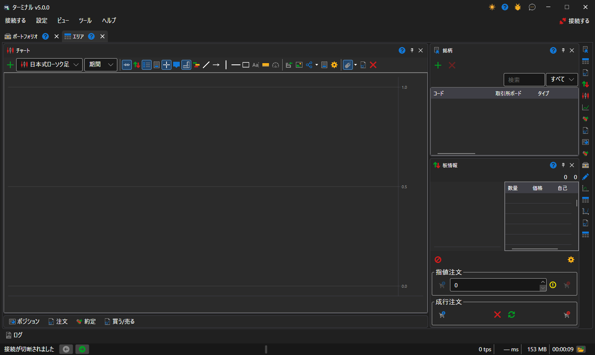
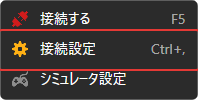
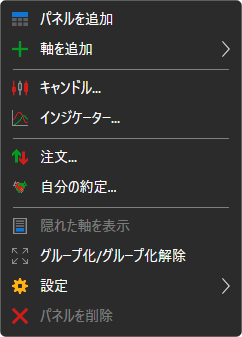
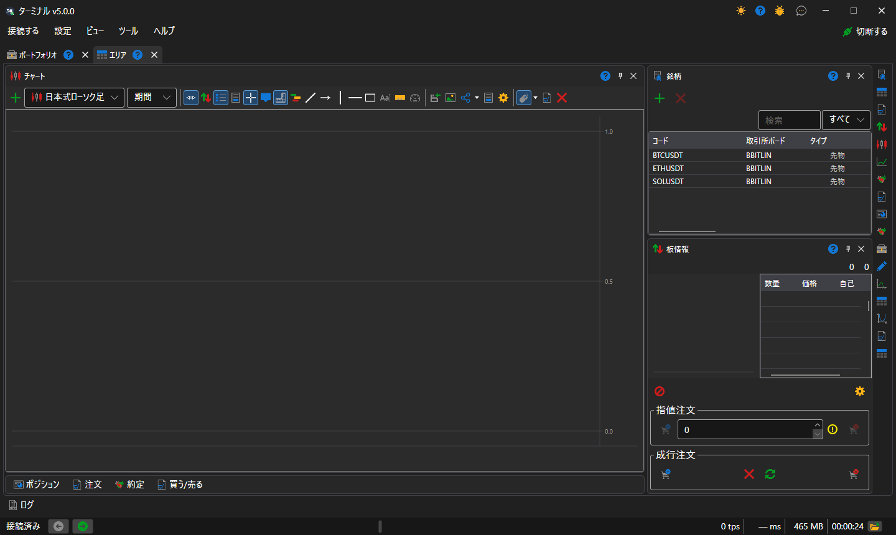
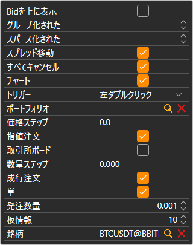
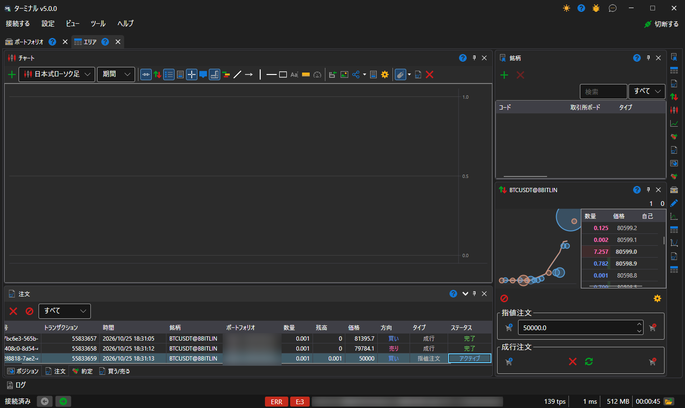
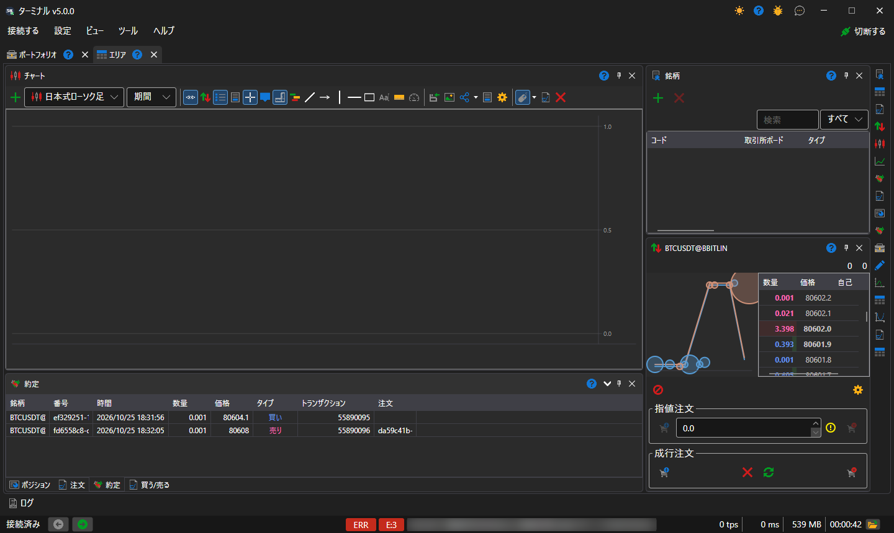
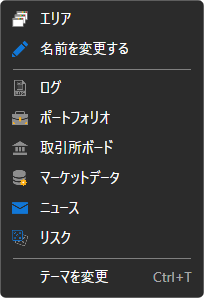

# クイックスタート

[Terminal](../terminal.md) を初めて起動すると、既定の配置の [ワークスペース](user_interface/workspace.md) を 1 つ持つウィンドウが開きます。中央にチャート、右側に銘柄と板情報、チャートの下には、折りたたまれたポジション、注文、約定、**買う/売る** チケットのタブがあります。

接続設定（**接続する → 接続設定** メニュー）に移動し、必要な接続を選択しましょう。接続の設定方法については、[接続設定](connection_settings.md)セクションで説明しています。

次のステップとして、[メインメニュー](user_interface/ribbon.md) の行の末尾にある **接続する** ボタンをクリックするか、**F5** キーを押して接続します。

チャートパネルの **追加**  ボタンをクリックして、新しいチャート領域を追加します。チャート領域でマウスを右クリックすると、関心のある銘柄のローソク足をそこに追加できます。チャートには、インジケーター、自分の約定、注文を追加できます。また、チャートから注文を登録することもできます。チャートの操作方法の詳細については、[チャート](user_interface/components/chart.md)セクションを参照してください。

銘柄パネルの **追加**  ボタンをクリックすると、監視したい銘柄を追加できます。ここには最良価格データが表示されます。銘柄パネルの操作方法の詳細については、[銘柄](user_interface/components/instruments.md)セクションを参照してください。

板情報で **設定**  ボタンをクリックすると、取引用の **銘柄** と **ポートフォリオ** を指定できるパネルが表示されます。ここでは板の深さも調整できます。板情報の操作方法の詳細については、[板情報](user_interface/components/order_book.md)セクションを参照してください。

最初のいくつかの注文を登録してみましょう。注文は、**買い/売り** ボタンをクリックするか、板情報自体の **買気配/売気配** 列のセルをダブルクリックすることで登録できます。注文パネルには、すべての注文が表示されます。注文を右クリックすると、新しい注文の送信、選択した注文のキャンセルまたは変更を行えるパネルが表示されます。注文パネルの操作方法の詳細については、[注文](user_interface/components/orders.md)セクションを参照してください。

約定パネルでは、銘柄別に約定を表示できます。約定パネルの操作方法の詳細については、[約定](user_interface/components/trades.md)セクションを参照してください。

必要に応じて、ワークスペースの右端のバーにあるボタンで追加のコンポーネントを追加できます。**ポートフォリオ** や **ログ** など、ウィンドウ全体のパネルは **ビュー** メニューから開きます。すべてのコンポーネントについては、[コンポーネント](user_interface/components.md)セクションで説明しています。

