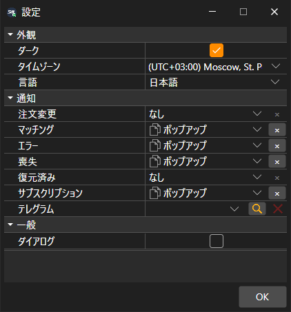

# 共通設定

**設定** ウィンドウは、[メインメニュー](../user_interface/ribbon.md) の **設定 → 設定** 項目で開きます。設定は次のグループに分かれています。

- **外観**:
  - **ダーク** — ダークテーマ。ウィンドウのタイトルバーのボタンでも切り替えられます。
  - **タイムゾーン** — マーケットデータの時刻を表示するタイムゾーン。
  - **言語** — プログラムの言語。
- **一般**:
  - **ダイアログ** — プログラム自身で処理できなかったエラーをウィンドウで表示します。チェックを外すと、そのようなエラーはログにのみ記録されます。
- **通知** — 注文と接続のどのイベントを、どの方法で知らせるか、およびそのメッセージ用の Telegram チャネル。詳しくは [通知](../notifications.md) セクションを参照してください。

テーマは **OK** をクリックするとすぐに変わります。言語とタイムゾーンは再起動後に有効になるため、Terminal は今すぐ再起動するかどうかを尋ねます。

## 推奨コンテンツ

[設定のリセット](reset_settings.md)

[通知](../notifications.md)
