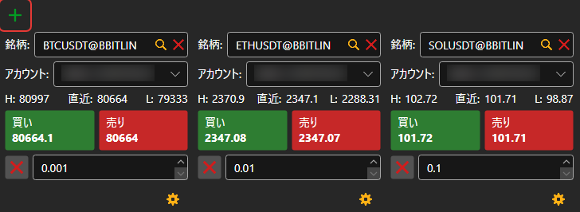
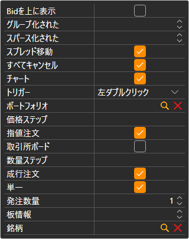

# 売買

**売買** コンポーネントは、チケットのグループです。各チケットには 1 つの銘柄の最良価格が表示され、選択したポートフォリオでその銘柄の注文を発注します。チケットは  ボタンで追加します。最初に接続したときは、パネルが取引所の最初の銘柄のチケットを自動的に作成します。

## チケットの設定

チケットの下にある歯車のボタンで、その設定が開きます。**銘柄**、**ポートフォリオ**、**発注数量**、板の深さ（**板情報**）、およびチケットに表示するブロックを指定します。

- **指値注文** — 価格フィールドを挟んだ **買い** ボタンと **売る** ボタン。フィールドの横のボタンで、最良買値または最良売値をフィールドに入力します。
- **成行注文** — 成行での **買い**、**売る**、**ポジションを閉じる**、**ポジションを反転する**。
- **すべてキャンセル** — チケットの銘柄のすべての注文を取り消すボタン。

チケットの銘柄は、[銘柄](instruments.md) の行をチケットにドラッグして変更できます。[ポジション](positions.md) の行をドラッグすると、チケットはその行の銘柄とポートフォリオを使用します。

## ホットキー

現在開いている [ワークスペース](../workspace.md) の **売買** パネルのチケットは、キーに反応します。**F9** — 成行で買い、**F10** — 成行で売り、**Esc** — すべての注文を取り消します。カーソルが入力フィールドにある間は、キーは機能しません。

> [!WARNING]
> **F9** と **F10** は、確認なしで実際の成行注文を取引所に送信します。

## 推奨コンテンツ

[板情報](order_book.md)

[Level 2](level_2.md)

[メインメニュー](../ribbon.md)
