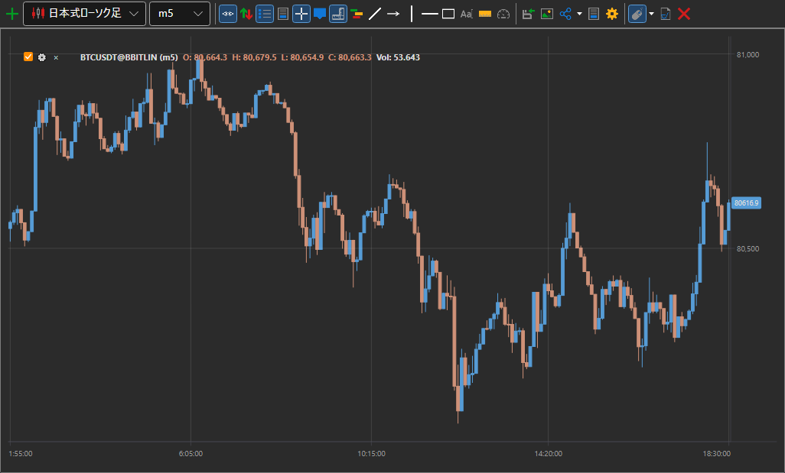
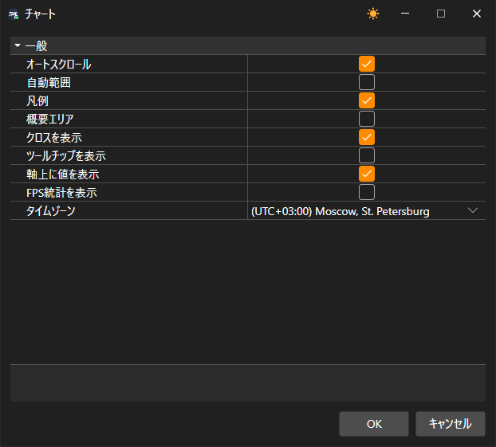
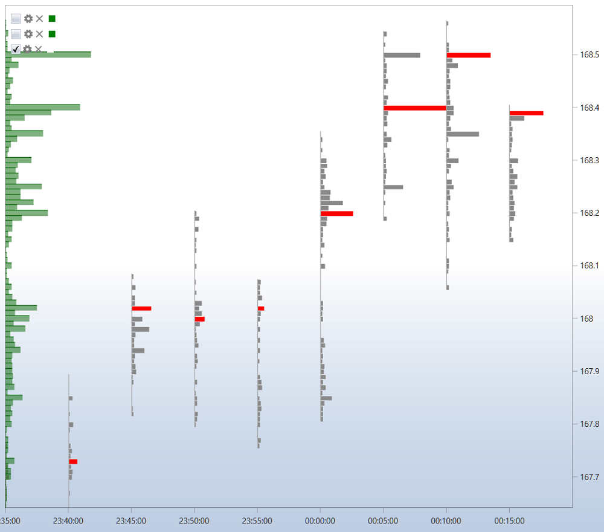

# チャート

**チャート** コンポーネントでは、選択した銘柄のローソク足とインジケーターを描画できます。

新しい領域を追加するには、 ボタンをクリックします。

チャートに新しい要素を追加するには、チャート領域内の任意の場所を右クリックし、必要な要素を選択します。利用可能なオプションには、ローソク足、インジケーター、注文、自己約定が含まれます。

各チャートの左上隅には、チャートに追加されたすべてのグラフィカル要素が表示されます。グラフィカル要素のチェックボックス  をオフにすると、その要素もチャートから削除されます。

 をクリックすると、グラフィック要素の設定が開きます。

## チャートからの取引

チャートから注文を発注、移動、取消できます。まず、チャートのボタンパネルで **チャートから注文を出す** スイッチをオンにし、そのドロップダウン設定で **銘柄**、**ポートフォリオ**、注文数量を指定します。

- 買い注文はチャート上の価格を **Ctrl キーを押しながら左クリック**、売り注文は **Ctrl キーを押しながら右クリック** して発注します。
- 自分のアクティブな注文は、チャート上にその価格のラインとして描画されます。ラインをつかんで別の価格へドラッグすると、注文が移動されます。ラインの横のバツ印で注文を取り消します。**注文をキャンセルする** ボタンは、チャートのすべての注文を取り消します。
- **クイック注文パネルを表示する** ボタンは、最良買値での **売る** ボタンと最良売値での **買い** ボタン、その間のスプレッド、注文数量を含むパネルをチャートの上に表示します。このパネルはチャートの任意の場所へドラッグできます。

> [!WARNING]
> チャートからの注文は、確認なしですぐに取引所に送信されます。

## チャートの設定

チャートのボタンパネルの **設定** ボタンで、チャート全体の設定ウィンドウが開きます。自動スクロールと自動スケール、凡例、表示領域、十字カーソル、ツールチップ、軸上の値、FPS の統計、時間軸のラベルに使うタイムゾーンを設定できます。

ボタンパネル自体を右クリックすると、そのボタンの一覧が開きます。チェックを外すとボタンが非表示になり、チェックを付けると再び表示されます。どのボタンを表示するかは、チャートと一緒に保存されます。

**クリップボード画像** ボタンは、チャートの画像をコピーして、メッセージや文書に貼り付けられるようにします。チャートの要素を右クリックすると、**要素パラメーター…** と **削除** の項目を含むメニューが開きます。チャート領域のメニューには **設定 → チャートエリア…** と **パネルを削除** があります。チャートの下のパネルは、そのタイトルのバツ印でも閉じられます。

チャートは矢印キー **←** と **→** でスクロールし、**Home** キーと **End** キーでデータの先頭と末尾に移動し、**+** と **−** で拡大・縮小します。

グラフィカル要素の設定では、必要なチャートスタイルを設定できます。日本式ローソク足、バー、ボックスチャート、クラスタープロファイルなどです。

ボックスチャートでは、ローソク足をグループ化することもできます。グループ化の順序は、2 番目のタイムフレームの乗数と 3 番目のタイムフレームの乗数のフィールドで設定します。

チャートの上にはツールバーがあり、自動スクロール、自動ズーム、凡例モード、その他の一般的なチャート設定を選択できます。また、チャート上に描画する要素として、線、レベル、ポインター、四角形、テキストを選択することもできます。

## 関連項目

[注文](../../../designer/user_interface/components/orders.md)
