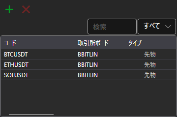

# 銘柄

**銘柄** コンポーネント（パネルのタイトルも **銘柄** です）は、選択したすべての銘柄に関する情報を表示する銘柄テーブルです。

新しい銘柄を追加するには、 ボタンをクリックします。銘柄の選択ウィンドウが開きます。このウィンドウには、検索と、銘柄の種類および取引所ボードによるフィルターがあり、銘柄の一覧を読み込んでいる間は、テーブルの下に読み込みバーが表示されます。**銘柄を削除する** ボタンは、選択した銘柄をテーブルから削除します。

テーブルで選択した銘柄は、同じワークスペースの **プロパティ** パネルに表示されます。ワークスペースのチャートに、注文を出す対象の銘柄がまだない場合は、選択した銘柄がその銘柄になります。

銘柄の行は、マウスでワークスペースの別のパネル（[売買](buy_sell.md)、[Level 1](level_1.md)、[Level 2](level_2.md)、[板情報](order_book.md)、[チャート](chart.md)）にドラッグでき、そのパネルはその銘柄に切り替わります。

行のコピー、検索とフィルター、列の設定については、[テーブルの操作](../tables.md) セクションで説明しています。

## 推奨コンテンツ

[Level 1](level_1.md)
