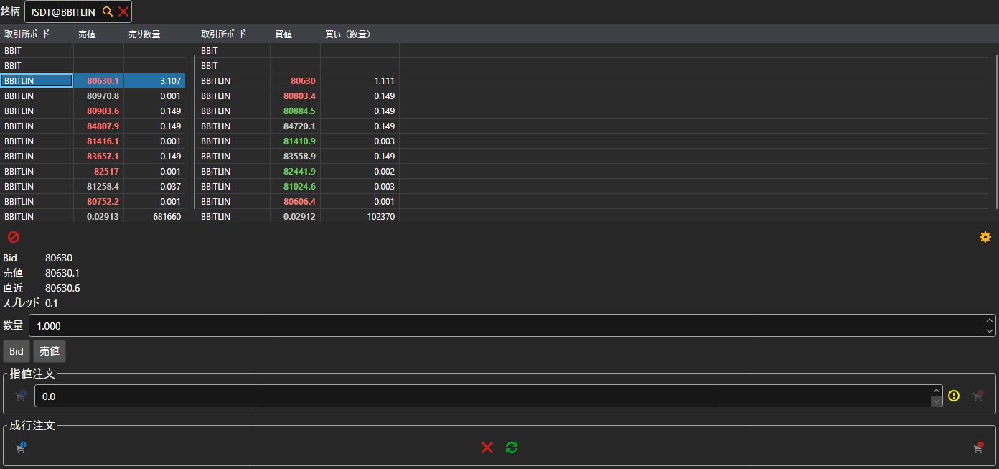

# Level 2

**Level 2** コンポーネントは、銘柄の気配値をすべての取引所で同時に表示します。同じコードを持つ銘柄がすべて、1 銘柄につき 1 行でテーブルに入ります。左のテーブルには最良売値とその数量、右のテーブルには最良買値とその数量が表示されます。銘柄は、テーブルの上のフィールドで選択するか、[銘柄](instruments.md) からパネルにドラッグします。

テーブルの下には、テーブルで選択した行の買値、売値、最終価格、スプレッドが表示されます。**Bid** ボタンと **売値** ボタンはその価格を指値注文に入力し、その下には [売買](buy_sell.md) コンポーネントと同じチケット（指値注文と成行注文）があります。

## 推奨コンテンツ

[板情報](order_book.md)

[売買](buy_sell.md)
