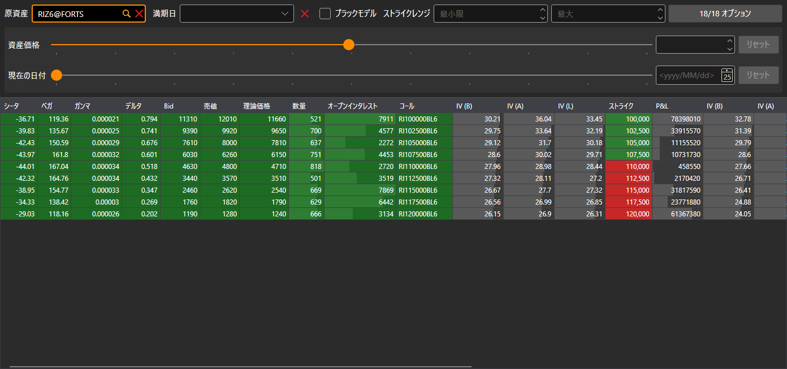

# オプションデスク

**オプションデスク** コンポーネントは、原資産に対するオプションの主要パラメーターを表示するテーブルです。テーブルの各行が権利行使価格で、左側にコール、右側にプットのパラメーターが表示されます。

## オプションのフィルター

テーブルの上にはフィルターがあります。このフィルターは、すべてのオプションコンポーネント（デスク、[スマイル・ボラティリティ](smile_volatility.md)、[ポジション（オプション）](positions_options.md)）で共通です。

- **原資産** — オプションを表示する対象の銘柄。
- **満期日** — この満期日のオプションだけを表示します。横のボタンでフィルターをクリアします。
- **ブラックモデル** — 理論価格、ボラティリティ、グリークスを、ブラック・ショールズ・モデルではなく、ブラックモデル（先物オプション向け）で計算します。
- **ストライクレンジ** — 最小および最大の権利行使価格。
- オプションの数が表示されたボタンは、原資産のオプションの選択ウィンドウを開きます。ボタンには、選択したオプションのうちフィルターを通過した数と、選択した総数が表示されます。

フィルターの下には「もしも」の計算があります。**資産価格** スライダーとその横のフィールドで原資産の別の価格を、**現在の日付** スライダーとカレンダーで別の現在日付を指定します。コンポーネントの計算はこれらの値で行われ、**リセット** ボタンで実際の価格と日付に戻ります。

## テーブル

「イン・ザ・マネー」の権利行使価格は強調表示されます。コールでは原資産価格より低い権利行使価格、プットでは高い権利行使価格です。

コールまたはプットのセルをダブルクリックすると、そのオプションの板情報が開きます。

## 推奨コンテンツ

[スマイル・ボラティリティ](smile_volatility.md)
