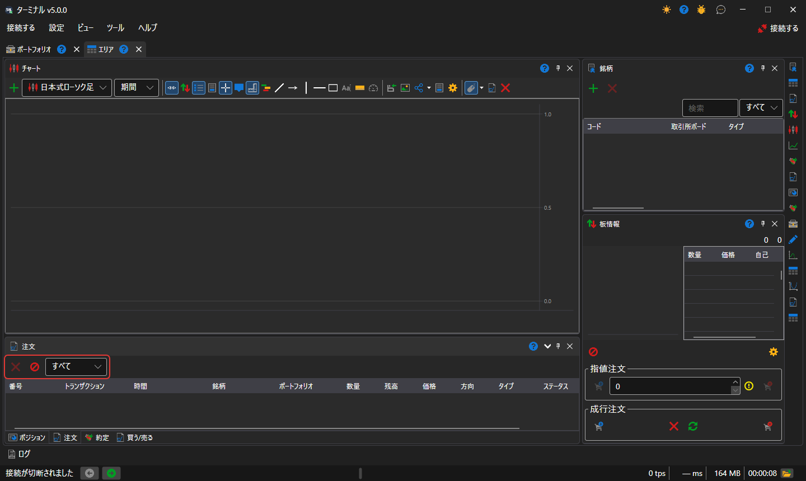
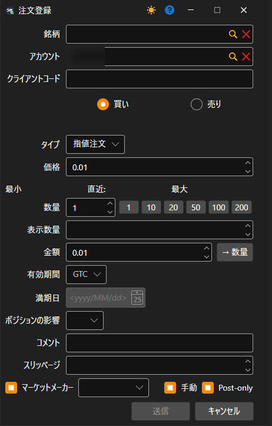
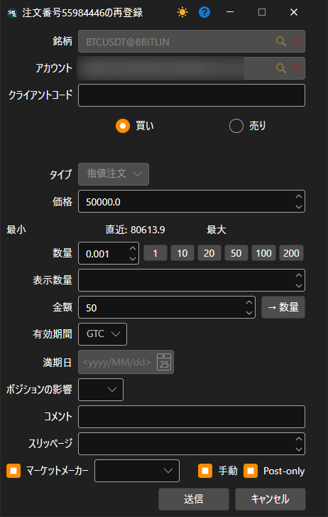

# 注文

**注文** コンポーネントは注文テーブルであり、すべての注文に関する完全な情報を表示します。

テーブルの上には 2 つのボタンがあります。**キャンセル** は選択した注文を取り消し、**すべての注文をキャンセルする** はすべてのアクティブな注文を取り消します。その横には、テーブルに表示する注文（すべて、アクティブ、約定済み、拒否）を選択するリストがあります。

注文上でマウスを右クリックすると、新しい注文の登録、選択した注文のキャンセルまたは変更を行えるパネルが表示されます。

**注文登録** ボタンをクリックすると、ウィンドウが表示されます。新しい注文を登録するには、内容を入力して **送信** をクリックします。

**注文変更** ボタンをクリックすると、ウィンドウが表示されます。注文を変更するには、必要な変更を行い、**送信** をクリックします。

## 推奨コンテンツ

[約定](../../../designer/user_interface/components/trades.md)
