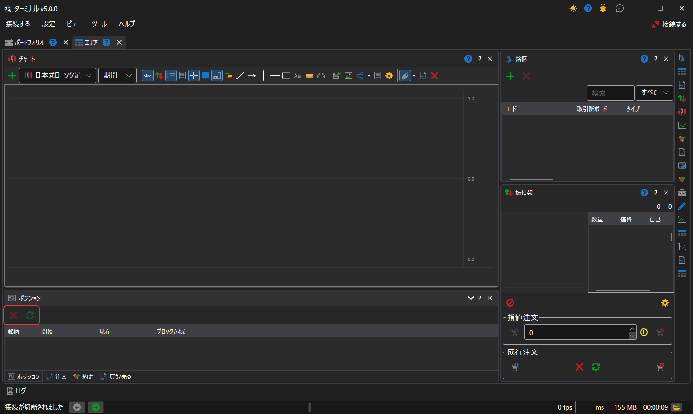

# ポジション

**ポジション** コンポーネントは、銘柄とポートフォリオごとの現在のポジション（数量、平均価格、損益）のテーブルです。

テーブルの上には、**ポジションを閉じる** ボタン（選択したポジションをゼロにする成行注文）と、**ポジションを反転する** ボタン（ポジションの 2 倍の数量の成行注文で、その後ポジションは同じ大きさで反対方向になります）があります。ポジションの行は [売買](buy_sell.md) チケットにドラッグできます。チケットはその行の銘柄とポートフォリオを使用します。

## 推奨コンテンツ

[ポジション](../../../designer/user_interface/components/positions.md)

[売買](buy_sell.md)
