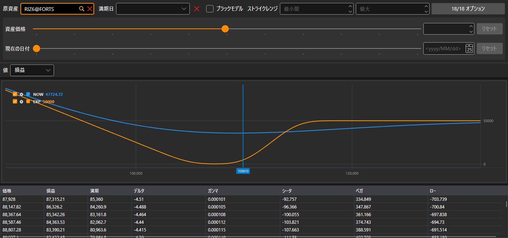

# ポジション（オプション）

**ポジション（オプション）** は、オプション別ポジションをグラフィカルに表示するもので、その指標が原資産の価格によってどのように変化するかを示します。

オプションは、[オプションデスク](option_desk.md) と同じフィルター（原資産、満期日、ストライクレンジ、オプション自体）で選択します。フィルターの下の「もしも」の計算では、原資産の別の価格や別の日付でのポジションを表示します。

**値** リストで、描画する対象（**損益**、**デルタ**、**ガンマ**、**シータ**、**ベガ**、**ロー**）を選択します。チャートの下には、原資産の価格ごとの値のテーブル（**価格**、現在の損益、**満期** 時の損益、グリークス）があります。

## 推奨コンテンツ

[オプションデスク](option_desk.md)
