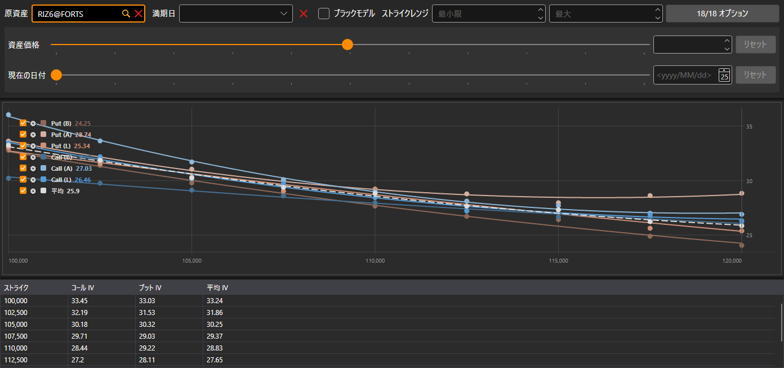

# スマイル・ボラティリティ

**スマイル・ボラティリティ** コンポーネントは、同じ原資産で異なる権利行使価格を持つオプションについて、予想されるボラティリティ水準をグラフィカルに表現したものです。

オプションは、[オプションデスク](option_desk.md) と同じフィルター（原資産、満期日、ストライクレンジ、オプション自体）で選択します。

チャートには 7 本の曲線があります。最良買値、最良売値、最終約定価格によるコールとプットのインプライド・ボラティリティと、点線で示される、各権利行使価格でのコールとプットのボラティリティの **平均** です。チャートの下にはテーブルがあり、**ストライク**、**コール** と **プット** のボラティリティ（最終約定価格によるもの。約定がなかった場合は最良買値または最良売値によるもの）、およびその **平均** が表示されます。

## 推奨コンテンツ

[オプションデスク](option_desk.md)

[ポジション（オプション）](positions_options.md)
