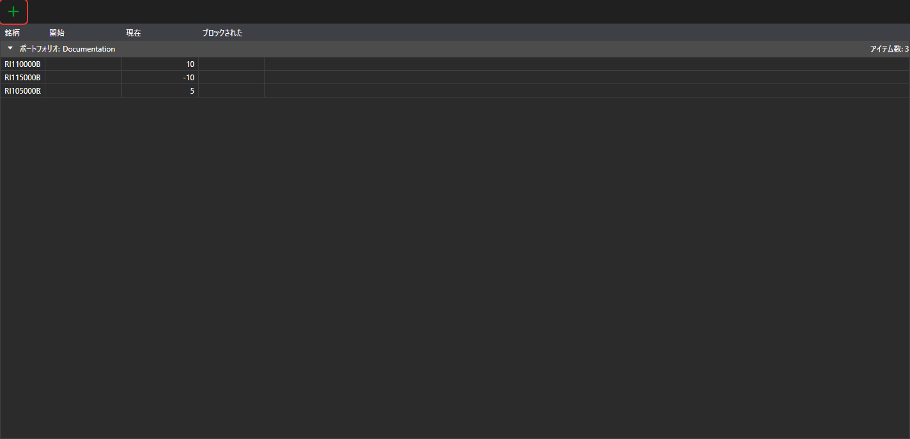

# ポートフォリオ

**ポートフォリオ** パネルには、ポートフォリオの情報と関連するポジションが表示されます。このパネルは、[メインメニュー](ribbon.md) の **ビュー → ポートフォリオ** 項目で開きます。

 ボタンはポジションを作成し、そのドロップダウンメニューからはポートフォリオまたはポジションを作成できます。行をダブルクリックすると、ポジションが編集用に開きます。

行を右クリックして開くメニューには、[テーブル](tables.md)の共通項目に加えて、次の項目があります。

- **編集** — ポジションを編集用に開きます。
- **ポジションを閉じる** — ポジションをクローズする成行注文を発注します。
- **ポジションを反転する** — ポジションの方向が変わるように、ポジションの 2 倍の数量の成行注文を発注します。
- **引き出し** — 取引所から資金を引き出します。ウィンドウで数量と引き出しの詳細を指定します。この項目は、資産のポジションがプラスで、ポートフォリオの接続が資金の引き出しに対応している場合に使用できます。
- **ゼロ残高を非表示** — 残高がゼロのポジションを表示しません。

ポートフォリオ、ポジション、およびその編集の詳細については、共通ガイドの [ポートフォリオ](../../designer/user_interface/portfolios.md) を参照してください。
