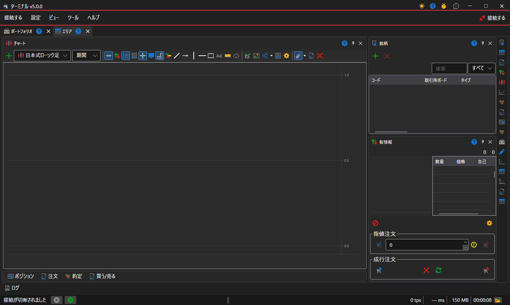

# メインメニュー

[Terminal](../../terminal.md) のウィンドウのタイトルの下には、メニューバー（**接続する**、**設定**、**ビュー**、**ツール**、**ヘルプ**）があります。バーの末尾には **接続する** ボタンがあり、Terminal を[設定済みのすべての接続](../connection_settings.md)に接続します。接続が確立している間、このボタンは **切断する** と表示されます。Terminal が接続している間は、接続とエミュレーターの設定は使用できません。

ウィンドウのタイトルバーの、最小化ボタンと閉じるボタンの横には、テーマの切り替え、ヘルプ、**問題を報告する**、**お問い合わせ** のボタンがあります。

## メニュー項目

- **接続する** — 接続と切断、[接続設定](../connection_settings.md)、および実際のマーケットデータで注文を約定させ、取引所には送信しないエミュレーターの設定。
- **設定** — プログラムの[共通設定](../settings/common_settings.md)、**レイアウトを保存...** と、パネルを元の位置に戻す **レイアウトをリセット**、[設定のリセット](../settings/reset_settings.md)、銘柄やポートフォリオに取引用の接続を割り当てる **銘柄と接続** ウィンドウと **ポートフォリオと接続** ウィンドウ。
- **ビュー** — 新しい[ワークスペース](workspace.md)（**エリア**）と現在のワークスペースの名前の変更（**名前を変更する**）、ウィンドウ全体のパネル（[ログ](logs.md)、[ポートフォリオ](portfolios.md)、[ボードエディター](board_editor.md)、**マーケットデータ**、[ニュース](components/news.md)、[リスク](risk_management.md)）、テーマの切り替え。
- **ツール** — **新しい銘柄を作成**、複数の銘柄からの **新しい指数銘柄**、限月の異なる先物からの **連続銘柄**。作成した銘柄は、開いているワークスペースの[銘柄](components/instruments.md)にすぐに表示されます。
- **ヘルプ** — **ドキュメント**、**バグレポート**、StockSharp チームへの連絡、**プログラムについて** ウィンドウ。

## ホットキー

| キー | 操作 |
|---|---|
| **F5** | 接続または切断 |
| **Ctrl+,** | 接続設定 |
| **Ctrl+S** | レイアウトを保存 |
| **Ctrl+T** | テーマの切り替え |
| **F1** | ヘルプを開く |
| **Alt+C**、**Alt+S**、**Alt+V**、**Alt+T**、**Alt+H** | **接続する**、**設定**、**ビュー**、**ツール**、**ヘルプ** メニューを開く |
| **F9** | アクティブな [売買](components/buy_sell.md) チケットで成行買い |
| **F10** | アクティブなチケットで成行売り |
| **Esc** | アクティブなチケットのすべての注文を取り消す |

アクティブなチケットとは、現在開いているワークスペースの **売買** パネルのチケットです。カーソルが入力フィールドにある間は、**F9**、**F10**、**Esc** キーは機能しません。

> [!WARNING]
> **F9** と **F10** は、確認なしで実際の成行注文を取引所に送信します。

## 推奨コンテンツ

[ワークスペース](workspace.md)

[コンポーネント](components.md)
