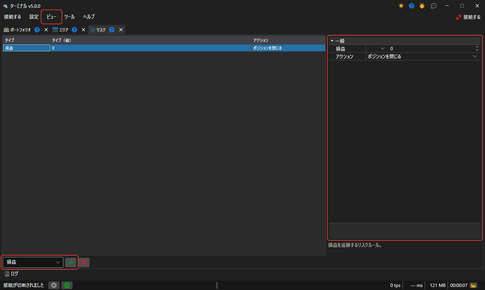

# リスク管理

**リスク** パネルでは、リスク管理設定を行うことができます。このパネルは、[メインメニュー](ribbon.md) の **ビュー → リスク** 項目で開きます。

**リスクルール** を追加するには、テーブルの下のリストでその種類を選択し、**ルールを追加** ボタンをクリックします。ルールがテーブルに表示され、右側にその設定が表示されます。**リスクルール** のトリガー条件と、条件が満たされたときに実行されるアクション（ポジションを閉じる、取引を停止、注文をキャンセル）です。設定の下には、選択したルールの説明が表示されます。**ルールを削除** ボタンは、選択したルールを削除します。

ルールは Terminal の接続によって、そこを通過する注文、約定、ポートフォリオのデータに対してチェックされます。ルールのセットは、プログラムを再起動しても保持されます。

リスクルールの一覧とその説明は、[リスク管理](../../designer/user_interface/risk_management.md)セクションで確認できます。
