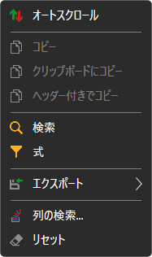
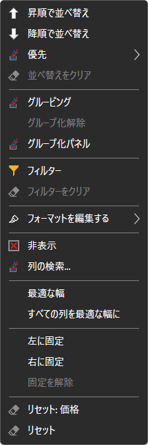

# テーブルの操作

[Terminal](../../terminal.md) のすべてのパネルのテーブル（銘柄、注文、約定、ポジション、ポートフォリオ、Level 1、注文ログ、ニュース）は、同じように動作します。

## テーブルのメニュー

テーブルの行を右クリックすると、メニューが開きます。

- **オートスクロール** — 新しい行に合わせてテーブルが自動的にスクロールします。
- **コピー**、**クリップボードにコピー** — 選択した行をクリップボードにコピーします。表示されている列が表示順にタブ区切りで並び、テーブルの 1 行がテキストの 1 行になります。**ヘッダー付きでコピー** は、1 行目に列名を追加します。**Ctrl+C** は **コピー** と同じ動作をします。
- **検索**（**Ctrl+F**） — テーブル内のテキストを検索します。検索する列を選択できます。**前の** ボタンと **次の** ボタンで見つかったセルの間を移動し、**クリア** で検索をリセットします。
- **式** — 列の値に対する条件で行をフィルターします。条件は `=[Price] > 100` のような数式で指定します。フィールドには列名と関数（`CONTAINS`、`STARTSWITH`、`ENDSWITH`、`TODAY`、`NOW` など）の候補が表示され、数式のエラーはすぐに示されます。**プレビュー** では、選択した行に対して数式がどのような結果になるかを確認できます。**適用** でフィルターを有効にし、**フィルターをクリア** で解除します。
- **エクスポート** — テーブルをクリップボード（CSV 形式のテキストまたは画像）、または CSV、Excel、PNG のファイルに出力します。**画像リンクを共有する** は、テーブルの画像を StockSharp のサイトにアップロードし、そのリンクをコピーします。これにはサイトへのサインインが必要です。**印刷** は、テーブルをブラウザーで開き、そこから印刷できるようにします。
- **列の検索...** — 列の表示と非表示を切り替えるウィンドウ。
- **リセット** — テーブルを元の表示に戻します。

## 列のメニュー

列の見出しを右クリックすると、その列のメニューが開きます。

- **昇順で並べ替え**、**降順で並べ替え**、**並べ替えをクリア**。見出しをクリックしても、その列でテーブルが並べ替えられます。**優先** は、既存の並べ替えにその列による並べ替えを追加し、複数の列で同時に並べ替えられるようにします。
- **グルーピング** — 列の値で行をグループ化します。**グループ化解除** で解除します。**グループ化パネル** にはグループ化のレベルが表示されます。列は一覧から追加するか、見出しをパネルにドラッグして追加できます。レベルの順序は入れ替えられ、レベルごとに並べ替えの方向を指定できます。
- **フィルター** — この列の値で行をフィルターします。**フィルターをクリア** で解除します。
- **フォーマットを編集する** — 列のセルを色で強調表示するルール。**ルールを追加** でルールを追加し、ルールは編集、無効化、削除できます。
- **非表示** — 列を非表示にします。**列の検索...** で元に戻します。
- 列の **最適な幅** と **すべての列を最適な幅に** — 内容に合わせた幅。
- **左に固定**、**右に固定**、**固定を解除** — 固定した列は、テーブルを横にスクロールしても同じ位置に残ります。
- 列またはテーブル全体の **リセット**。

テーブルの表示（表示する列、その順序と幅）は、ウィンドウのレイアウトと一緒に保存されます。

## 推奨コンテンツ

[ワークスペース](workspace.md)

[コンポーネント](components.md)
