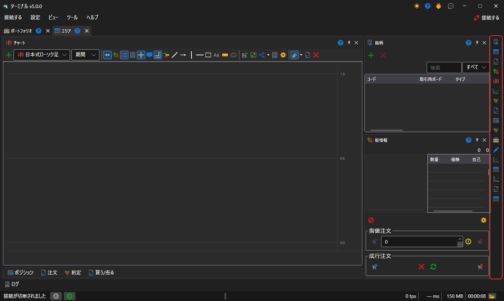
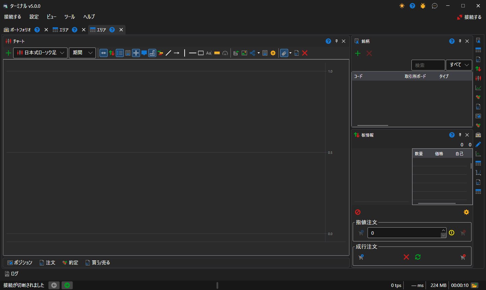

# ワークスペース

ワークスペースは、独自のパネル（チャート、テーブル、チケット）のセットを持つ [Terminal](../../terminal.md) ウィンドウのタブです。ワークスペースはいくつでも作成でき、それぞれ独立して動作します。あるワークスペースで選択した銘柄は、ほかのワークスペースのパネルを変更しません。

新しいワークスペースは [メインメニュー](ribbon.md) の **ビュー → エリア** 項目で作成し、現在のワークスペースの名前は **ビュー → 名前を変更する** 項目で変更します。

## ワークスペースのパネル

パネルは、ワークスペースの右端にある縦のバーのボタンで追加します。各 [コンポーネント](components.md) に 1 つずつボタンがあります。ボタンを押すたびにその種類のパネルがもう 1 つ開くため、1 つのワークスペースに、たとえば異なる銘柄の 2 つのチャートを置くこともできます。パネルは、タイトルをドラッグしてワークスペース内の別の場所へ移動したり、隣のパネルの端にドッキングしたり、隣のパネルとタブにまとめたり、別ウィンドウに切り離したりできます。

## 新しいワークスペースのレイアウト

新しいワークスペースは、取引端末で一般的な配置になっています。中央に全高のチャート、右側に [銘柄](components/instruments.md) とその下に [板情報](components/order_book.md)、そして **ポジション**、**注文**、**自分の約定** のテーブルと **買う/売る** チケットが、チャートの下のタブ行に折りたたまれています。タブをクリックするとテーブルが展開され、そのタイトルのボタンで再び折りたたまれます。テーブルが折りたたまれているかどうかは、パネルの配置と一緒に Terminal が記憶します。

Terminal は、変更のたびにパネルの配置を自動的に保存します。**設定 → レイアウトを保存...**（Ctrl+S）はすぐに保存し、**設定 → レイアウトをリセット** はパネルを元の位置に戻します。

## 推奨コンテンツ

[メインメニュー](ribbon.md)

[コンポーネント](components.md)
