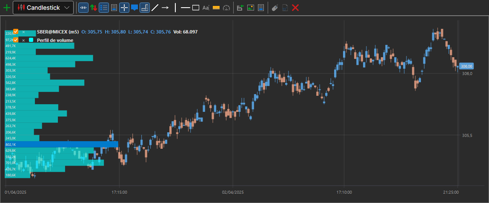

# Perfil de volume

**Perfil de volume** é um indicador avançado que apresenta a atividade de negociação durante um determinado período e em determinados níveis de preço. O indicador é um histograma no gráfico que mostra níveis de preço predominantes ou importantes com base no volume.

Para usar o indicador, deve usar a classe [VolumeProfileIndicator](xref:StockSharp.Algo.Indicators.VolumeProfileIndicator).

## Conteúdo recomendado

[Média móvel ponderada por volume](volume_weighted_ma.md)
