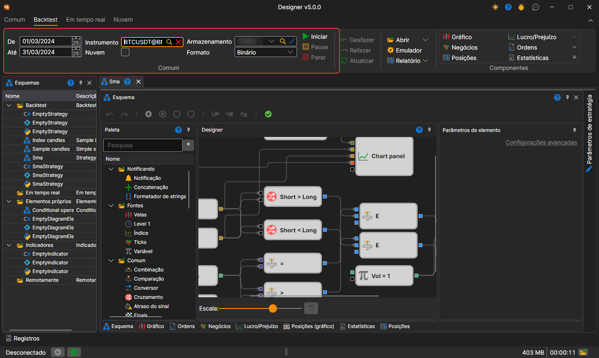
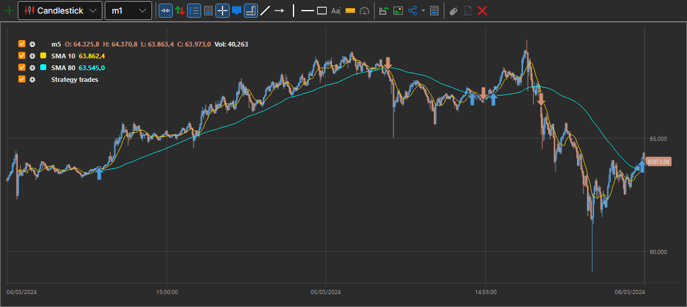
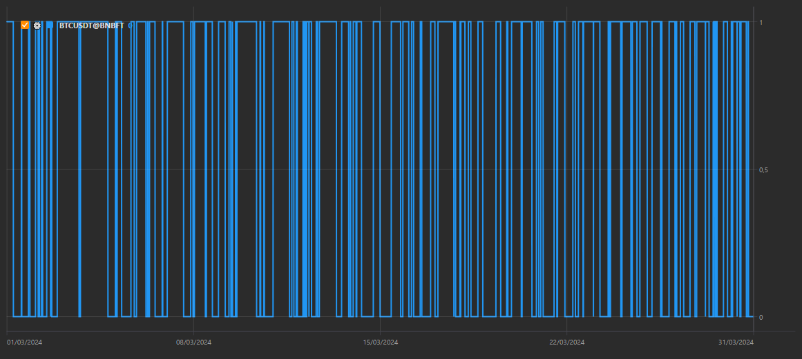
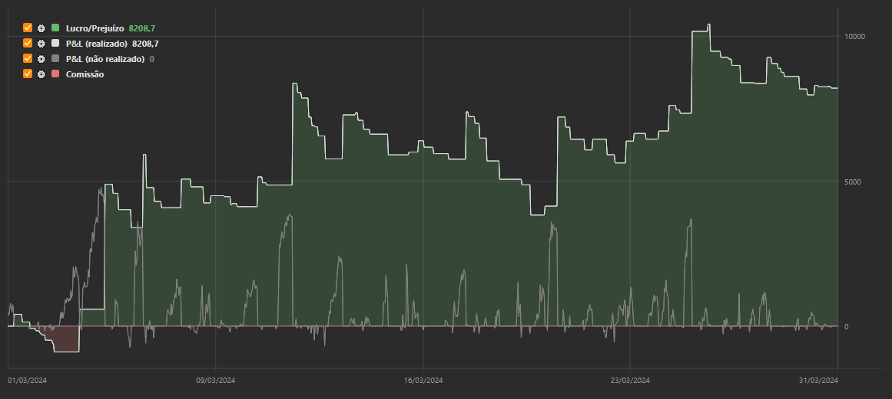

# Primeiros passos

Como exemplo, será considerada a estratégia SMA.

Para executar o teste no histórico, deve selecionar uma estratégia cujo esquema será testado no histórico. A estratégia é selecionada no [Painel de esquemas](../user_interface/schemas.md), na pasta da estratégia, fazendo duplo clique na estratégia pretendida.

Antes do teste, carregue os dados de mercado (instrumentos, velas, negócios por tick e\/ou livros de ordens). Isto é descrito em [Armazenamento de dados de mercado](../market_data_storage.md).

Ao mudar para o separador com uma estratégia, o separador **Backtest** abre automaticamente no **Friso**. Nele, defina o período de teste (**De** e **Até**), selecione o instrumento no campo **Instrumento** e, nos campos **Armazenamento** e **Formato**, o armazenamento de dados de mercado ([Armazenamento de dados de mercado](../market_data_storage.md)) e o formato em que está gravado.

No exemplo com a estratégia SMA são usados os seguintes parâmetros:

1. Instrumento BTCUSDT@BNBFT
2. Período de 01.03.2024 a 31.03.2024
3. Armazenamento no qual foram carregadas as velas deste instrumento para este período
4. Formato do armazenamento **Binário**

A própria estratégia constrói duas médias móveis sobre velas de cinco minutos — **SMA 10** e **SMA 80** — e negoceia com o volume definido pelo cubo **Vol = 1** do esquema.

Depois de configurar todos os parâmetros necessários, inicie o teste da estratégia clicando no botão .

Durante ou após o teste, pode ver gráficos e tabelas com a informação do teste.

O gráfico mostra que os negócios ocorrem no cruzamento das médias móveis, conforme previsto pela estratégia.

No gráfico **Posições (gráfico)** vê-se que a posição da estratégia alterna entre 0 e 1: a estratégia compra quando a média curta cruza a longa de baixo para cima e fecha a posição no cruzamento inverso.

O gráfico **P\/L** mostra como variaram os lucros e as perdas da estratégia durante o teste, bem como a comissão.

## Conteúdo recomendado

[Execução real](../live_execution/getting_started.md)
